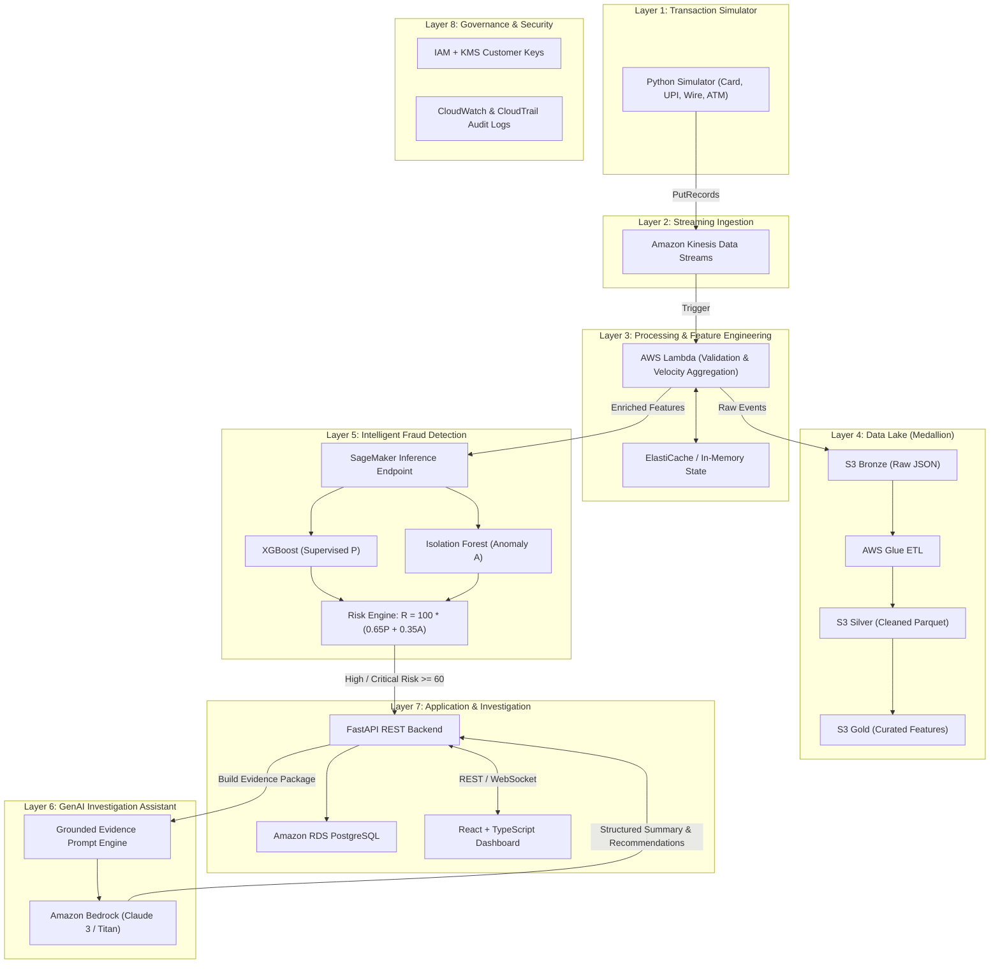

# FinGuard AI — Real-Time Financial Fraud Detection & GenAI Investigation Platform

[](docs/architecture/system-architecture.md)
[](https://www.python.org/)
[](https://fastapi.tiangolo.com/)
[](frontend/)
[](infrastructure/terraform/)
[](LICENSE)

FinGuard AI is an end-to-end, enterprise-grade financial fraud detection and GenAI investigation platform deployed on AWS. The system processes streaming transactions in real time, computes dynamic behavioral velocity features, runs dual-layer machine learning models (Supervised Classification + Unsupervised Anomaly Detection), computes a unified composite risk score, and empowers financial crime investigators with an evidence-grounded Amazon Bedrock Generative AI Copilot.

---

## Table of Contents
- [Executive Overview](#executive-overview)
- [Enterprise Architecture](#enterprise-architecture)
- [Multi-Layer System Flow](#multi-layer-system-flow)
- [Key Business & Functional Capabilities](#key-business--functional-capabilities)
- [Technology Stack](#technology-stack)
- [Repository Structure](#repository-structure)
- [Data Lake & Medallion Architecture](#data-lake--medallion-architecture)
- [Fraud Scoring & Risk Formulation](#fraud-scoring--risk-formulation)
- [GenAI Investigation Workflow & Governance](#genai-investigation-workflow--governance)
- [Implementation Milestones](#implementation-milestones)
- [Getting Started (Local Development)](#getting-started-local-development)
- [Documentation Index](#documentation-index)

---

## Executive Overview

Modern financial institutions process tens of thousands of transactions per second across credit cards, real-time UPI/IMPS payments, wire transfers, and ATMs. Legacy rule-based detection systems suffer from severe limitations:
1. **Excessive False Positive Rates:** Over 90% of rule alerts are false positives, causing massive operational investigator fatigue.
2. **Detection Latency:** Batch detection allows fraudsters to siphon funds before accounts can be restricted.
3. **Inability to Detect Zero-Day Fraud:** Static heuristics fail against novel synthetic identity, account takeover (ATO), and velocity attacks.
4. **Opaque Investigator Workflows:** Manual dossier creation takes 45–90 minutes per case, with minimal standardized auditability.

**FinGuard AI's Enterprise Solution:**
- **Streaming Pipeline:** Ingests events via **Amazon Kinesis Data Streams** with sub-second delivery.
- **Serverless Feature Engineering:** Computes micro-batch velocity aggregates (1m, 5m, 1h, 24h spending deviations) via **AWS Lambda**.
- **Dual-Model ML Detection:** Combines **XGBoost** (calibrated supervised fraud probabilities) and **Isolation Forest** (unsupervised spatial anomaly detection).
- **Separation of Concerns:** ML calculates numerical risk; **Amazon Bedrock (Claude 3 / Titan)** delivers evidence-grounded investigation narratives without hallucinating fraud decisions.
- **Human-in-the-Loop Case Management:** Full investigator workbench in **React** backed by a high-throughput **FastAPI** service and **PostgreSQL** audit trail.

---

## Enterprise Architecture



---

## Multi-Layer System Flow

1. **Layer 1 — Transaction Sources:** High-fidelity Python simulator emulating card swipes, mobile transfers, ATM withdrawals, and simulated fraud bursts (ATO, card testing, sudden cross-border velocity).
2. **Layer 2 — Streaming Ingestion:** Amazon Kinesis Data Streams configured with dynamic partition keys (e.g., `account_id`) ensuring sequence preservation per account.
3. **Layer 3 — Validation & Enrichment:** AWS Lambda validates payload schemas against strict JSON contracts, eliminates duplicates via idempotency keys, and extracts rolling customer velocity metrics.
4. **Layer 4 — Data Lake:** AWS S3 structured in Bronze (raw ingestion logs), Silver (cleansed and partitioned Parquet data), and Gold (curated feature marts for historical retraining via Athena and Glue).
5. **Layer 5 — Fraud Scoring Engine:** SageMaker endpoints serving XGBoost and Isolation Forest models. The risk engine executes:
   $$R = 100 \times (0.65 \times P + 0.35 \times A)$$
   Transactions with $R \ge 60$ automatically spawn high-priority investigation cases.
6. **Layer 6 — GenAI Investigation:** Bedrock synthesizes behavioral discrepancies into plain-language executive summaries with suggested step-by-step audit actions.
7. **Layer 7 — Case Management Dashboard:** React UI providing real-time alert triage, geographic deviation maps, interactive timeline analysis, and human decision recording (Approve / Decline / Escalation).
8. **Layer 8 — Enterprise Security & Compliance:** Least-privilege IAM roles, KMS envelope encryption at rest, TLS 1.3 in transit, and immutable PostgreSQL audit logs.

---

## Technology Stack

| Domain | Technology | Enterprise Purpose |
| :--- | :--- | :--- |
| **Backend & Core** | Python 3.11, FastAPI | Asynchronous high-throughput REST APIs & business logic |
| **Database** | PostgreSQL 15, SQLAlchemy, Alembic | ACID transactional persistence & audit trails |
| **Streaming Pipeline** | Amazon Kinesis Data Streams | Sub-second distributed event ingestion |
| **Event Compute** | AWS Lambda | Serverless real-time validation & feature enrichment |
| **Data Lake** | Amazon S3, AWS Glue, Amazon Athena | Medallion storage architecture & historical SQL analytics |
| **Machine Learning** | XGBoost, Scikit-learn, SageMaker | Supervised classification & unsupervised anomaly detection |
| **Generative AI** | Amazon Bedrock (Claude 3 Sonnet / Haiku) | Grounded investigation summaries & SAR assistance |
| **Frontend UI** | React 18, TypeScript, TailwindCSS, Recharts | Real-time investigator console and KPI telemetry |
| **Infrastructure as Code** | Terraform | Reproducible multi-environment provisioning (Dev/Staging/Prod) |
| **Observability** | AWS CloudWatch, CloudTrail | Real-time metrics, dead-letter queues, and compliance logging |
| **Containers & CI/CD** | Docker, GitHub Actions | Containerized microservices & automated CI/CD pipelines |

---

## Repository Structure

```
finguard-ai-fraud-detection/
├── README.md                           # Master project guide & architecture
├── LICENSE                             # Apache 2.0 Open Source License
├── .gitignore                          # Standard enterprise gitignore
├── .env.example                        # Environment variables template
├── Makefile                            # Automation recipes for dev & test
├── docker-compose.yml                  # Local development stack (Postgres, Redis)
│
├── docs/                               # Architectural & Engineering Specifications
│   ├── architecture/                   # System, Data Flow, Deployment, Security
│   ├── requirements/                   # Business, Functional, Non-Functional
│   ├── database/                       # Relational schema, Alembic, ER diagrams
│   └── api/                            # OpenAPI 3.1 REST endpoint definitions
│
├── data/                               # Data artifacts & schemas
│   ├── schemas/                        # JSON Schemas for events & features
│   ├── raw/                            # Sample raw transaction records (.gitkeep)
│   ├── processed/                      # Sample cleansed records (.gitkeep)
│   ├── features/                       # Curated feature tables (.gitkeep)
│   └── samples/                        # Synthetic benchmark payloads
│
├── transaction_simulator/              # High-throughput Python event producer
├── ingestion/                          # Lambda stream consumers & DLQ handlers
├── data_engineering/                   # Feature engineering & Glue ETL pipelines
├── ml/                                 # Training, inference, and evaluation pipeline
├── genai/                              # Bedrock investigation client & prompts
├── backend/                            # FastAPI REST service & PostgreSQL ORM
├── frontend/                           # React + TypeScript investigator UI
├── infrastructure/terraform/           # Modular Terraform for AWS provisioning
├── deployment/                         # Dockerfiles and deployment automation
├── monitoring/                         # CloudWatch dashboard definitions & alarms
└── tests/                              # Pytest test suite (Unit, Int, E2E, Perf)
```

---

## Fraud Scoring & Risk Formulation

The risk decision engine separates empirical model predictions from AI reasoning. 

```
                                      +--------------------+
                                      | Transaction Event  |
                                      +---------+----------+
                                                |
                               +----------------+----------------+
                               |                                 |
                               v                                 v
                     +-------------------+             +--------------------+
                     | XGBoost Model (P) |             | Isolation Forest(A)|
                     | Supervised Prob   |             | Normalized Anomaly |
                     +---------+---------+             +---------+----------+
                               |                                 |
                               +----------------+----------------+
                                                |
                                                v
                                  +---------------------------+
                                  |     Risk Calculation      |
                                  |  R = 100 * (0.65P + 0.35A)|
                                  +-------------+-------------+
                                                |
                 +------------------------------+------------------------------+
                 |                              |                              |
                 v                              v                              v
           0 <= R < 30                    30 <= R < 60                    60 <= R <= 100
         [LOW RISK]                    [MEDIUM RISK]                  [HIGH / CRITICAL]
        Normal Flow                 Enhanced Monitoring             Case Created -> Bedrock
```

| Risk Score | Tier | Automated Action |
| :--- | :--- | :--- |
| **0 – 29** | Low | Instant approval; normal settlement |
| **30 – 59** | Medium | Elevated transaction logging; secondary verification flag |
| **60 – 79** | High | Investigation case created; flagged for analyst review |
| **80 – 100** | Critical | Instant transaction hold; priority investigation dossier generated |

---

## Implementation Milestones

- [x] **Phase 1: Project Foundation & Enterprise Architecture** *(Current Phase)*
- [ ] **Phase 2: Transaction Simulator & Realistic Banking Dataset**
- [ ] **Phase 3: Kinesis Streaming Ingestion Pipeline**
- [ ] **Phase 4: Lambda Stream Processing & Velocity Feature Store**
- [ ] **Phase 5: Amazon S3 Data Lake & AWS Glue ETL**
- [ ] **Phase 6: Machine Learning Fraud Classification & Anomaly Detection**
- [ ] **Phase 7: Amazon Bedrock GenAI Investigation Assistant**
- [ ] **Phase 8: FastAPI Backend & PostgreSQL Operational Database**
- [ ] **Phase 9: React Investigation Console**
- [ ] **Phase 10: Infrastructure as Code (Terraform) & CI/CD**
- [ ] **Phase 11: Enterprise Security, Governance & Observability**
- [ ] **Phase 12: End-to-End Integration, Validation & Load Testing**

---

## Getting Started (Local Development)

### 1. Prerequisites
- **Python 3.11+**
- **Node.js 18+** & npm
- **Docker & Docker Compose**
- **AWS CLI v2** configured with `ap-south-1` (for cloud deployment)

### 2. Environment Setup
```bash
# Clone the repository
git clone https://github.com/organization/finguard-ai-fraud-detection.git
cd finguard-ai-fraud-detection

# Copy environment template
cp .env.example .env

# Create Python virtual environment
python -m venv .venv
source .venv/bin/activate  # On Windows: .venv\Scripts\Activate.ps1
pip install --upgrade pip
pip install -r backend/requirements.txt
```

### 3. Launch Local Database & Caching
```bash
docker compose up -d
```

### 4. Run Tests
```bash
pytest tests/unit -v
```

---

## Documentation Index
- [System Architecture](docs/architecture/system-architecture.md)
- [Data Flow Pipeline](docs/architecture/data-flow.md)
- [Deployment Architecture](docs/architecture/deployment-architecture.md)
- [Security Architecture](docs/architecture/security-architecture.md)
- [Business Requirements](docs/requirements/business-requirements.md)
- [Functional Requirements](docs/requirements/functional-requirements.md)
- [Non-Functional Requirements](docs/requirements/non-functional-requirements.md)
- [Database Schema Specification](docs/database/schema.md)
- [Entity-Relationship Diagram](docs/database/er-diagram.md)
- [REST API Specification](docs/api/api-specification.md)

