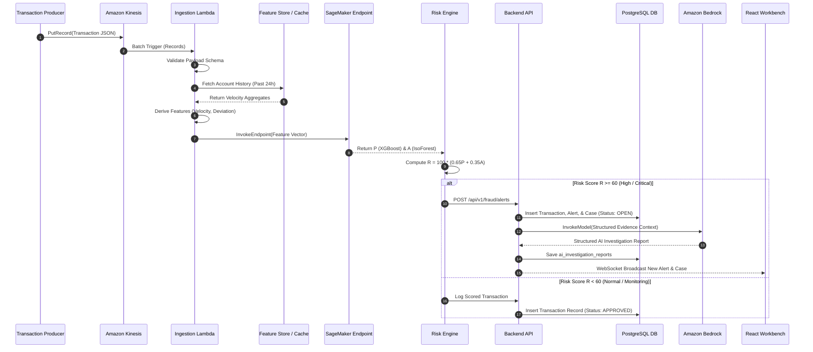

# FinGuard AI — Data Flow Pipeline Specification

## 1. End-to-End Pipeline Overview

The data flow within FinGuard AI traverses two parallel paths:
1. **The Fast Path (Streaming Inference & Triage):** Sub-second ingestion, feature calculation, risk scoring, and real-time alert generation.
2. **The Batch/Analytical Path (Data Lake & Continuous Learning):** Medallion S3 storage, Glue transformations, Athena querying, and SageMaker model retraining.

---

## 2. Sequence Diagram: Fast Path (Real-Time Scoring & AI Investigation)

---

## 3. Data Lake Ingestion & Transformation Flow (Medallion)

```mermaid
flowchart LR
    subgraph S3_Bronze["Bronze (Raw)"]
        B1["s3://finguard-data/bronze/transactions/year=YYYY/month=MM/day=DD/"]
    end

    subgraph Glue_Job["AWS Glue ETL Job"]
        G1["Schema Validation & Parsing"]
        G2["Deduplication by transaction_id"]
        G3["Parquet Conversion & Snappy Compression"]
    end

    subgraph S3_Silver["Silver (Cleaned)"]
        S1["s3://finguard-data/silver/transactions/"]
    end

    subgraph Athena_Marts["Athena Feature Marts"]
        M1["Historical Customer Baseline"]
        M2["Merchant Risk Aggregates"]
    end

    subgraph S3_Gold["Gold (Curated ML Data)"]
        GOLD1["s3://finguard-data/gold/fraud-features/"]
    end

    B1 --> G1 --> G2 --> G3 --> S1
    S1 --> Athena_Marts --> GOLD1
```

---

## 4. Latency Budget Allocation (Target: < 5s at p95)

| Step | Operation | Target Latency (p95) |
| :--- | :--- | :--- |
| **1** | Producer to Kinesis Ingestion | < 80 ms |
| **2** | Kinesis Trigger to Lambda Invocation | < 250 ms |
| **3** | Schema Validation & Idempotency Check | < 20 ms |
| **4** | Historical Feature Lookup (In-memory/Redis) | < 30 ms |
| **5** | Feature Vector Compilation | < 10 ms |
| **6** | SageMaker Dual Model Inference (XGB + IF) | < 120 ms |
| **7** | Risk Score Calculation & Rule Check | < 5 ms |
| **8** | PostgreSQL Case & Alert Insertion | < 60 ms |
| **9** | Bedrock GenAI Summary (Asynchronous) | < 3000 ms |
| **Total Synchronous Scoring Latency** | **Fast-Path Decision** | **< 600 ms** |
| **Total Case Creation & AI Dossier** | **Full Investigation Record** | **< 3800 ms** |
