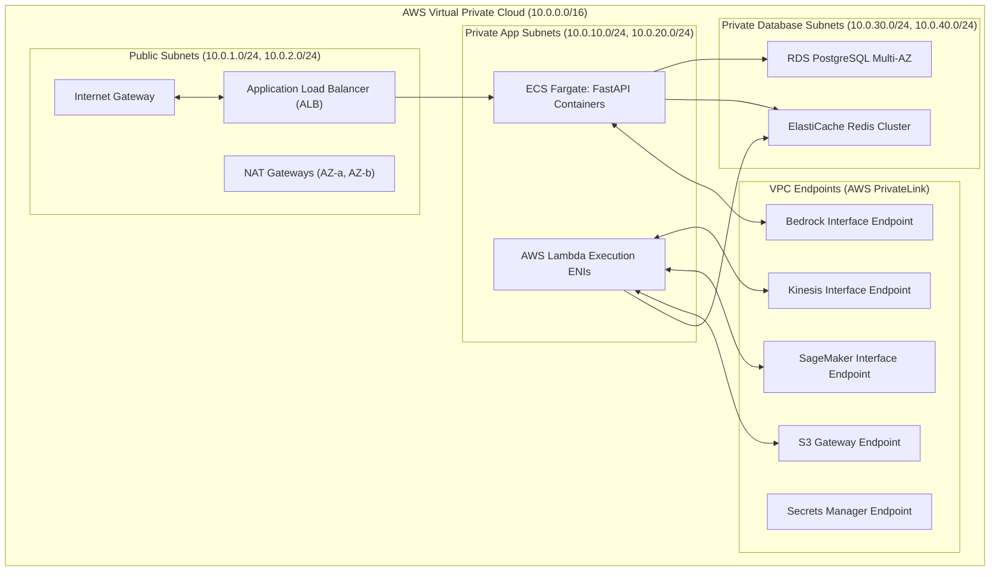

# FinGuard AI — Deployment Architecture Specification

## 1. Multi-Environment Infrastructure Strategy

FinGuard AI uses a modular Terraform architecture across four deployment tiers:

```
[Local Dev: Docker Compose] ---> [AWS Dev] ---> [AWS Staging] ---> [AWS Production]
```

| Dimension | AWS Dev | AWS Staging | AWS Production |
| :--- | :--- | :--- | :--- |
| **AWS Region** | `ap-south-1` (Mumbai) | `ap-south-1` (Mumbai) | `ap-south-1` (Mumbai) |
| **Kinesis Stream** | 1 Shard, On-Demand | 2 Shards, Provisioned | 4–16 Shards, Auto-scaling |
| **Compute: API** | ECS Fargate (1 Task) | ECS Fargate (2 Tasks) | ECS Fargate (Auto-scaling 4-20) |
| **Compute: Lambda**| 512 MB, x86_64 | 1024 MB, arm64 (Graviton) | 1024 MB, arm64, Provisioned Concurrency |
| **Database** | RDS PostgreSQL db.t4g.small | RDS PostgreSQL db.t4g.medium Multi-AZ | RDS Aurora PostgreSQL db.r6g.large Multi-AZ |
| **SageMaker** | Serverless Inference | 1x `ml.m5.large` | Multi-instance Auto-scaling `ml.c6i.xlarge` |
| **GenAI Model** | Bedrock Claude 3 Haiku | Bedrock Claude 3 Sonnet | Bedrock Claude 3.5 Sonnet / Provisioned Throughput |
| **Backup Retention** | 7 days | 14 days | 35 days continuous + Point-in-time |

---

## 2. AWS Network Architecture (VPC & Subnets)



---

## 3. Deployment Pipeline (CI/CD via GitHub Actions)

- **Triggers:** Pull requests to `main` and tagged releases (`v*.*.*`).
- **Pipeline Stages:**
  1. **Static Analysis & Linting:** `flake8`, `black`, `isort`, `eslint`, `tsc`.
  2. **Automated Testing:** Pytest unit tests, integration tests with testcontainers.
  3. **Security Scanning:** `bandit` (Python AST), `trivy` (container vulnerabilities), `tfsec` (Terraform policy violations).
  4. **Build & Push:** Docker container images tagged and pushed to Amazon ECR.
  5. **Terraform Apply:** Terraform execution targeted to designated environment workspace.
  6. **Zero-Downtime Deployment:** ECS Fargate blue/green deployment via AWS CodeDeploy.

