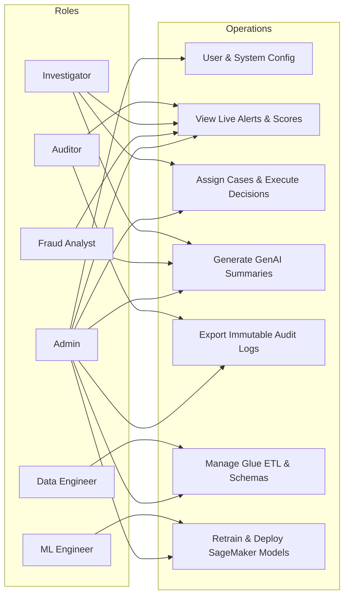

# FinGuard AI — Security & Governance Architecture

## 1. Compliance & Security Baseline
Financial transaction processing mandates adherence to ISO 27001, PCI-DSS Level 1 principles, and SOC-2 Type II controls. Even with synthetic data in development, FinGuard AI implements production-ready security standards.

---

## 2. Core Security Pillars

| Security Domain | Architectural Mechanism | Implementation Details |
| :--- | :--- | :--- |
| **Authentication** | JSON Web Tokens (JWT) | Asymmetric RSA256 / HMAC-SHA256 tokens with 60-minute expiry and refresh rotation. |
| **Authorization** | Role-Based Access Control (RBAC) | Enforced on every FastAPI route and database row-level security. |
| **Data at Rest** | AWS KMS Customer Managed Keys | Envelope encryption across S3 buckets, RDS volumes, Kinesis streams, and CloudWatch logs. |
| **Data in Transit** | TLS 1.3 Strict | Mandatory HTTPS via ALB and TLS for all database and Redis network hops. |
| **Secrets Management** | AWS Secrets Manager | Auto-rotating database credentials and API signing keys; zero hardcoded secrets. |
| **Infrastructure Audit**| AWS CloudTrail & VPC Flow Logs | Continuous immutable API activity logging to a dedicated S3 archive bucket. |
| **PII Protection** | Tokenization & Hashing | Customer account numbers, PANs, and IP addresses are masked/salted prior to analytics indexing. |

---

## 3. Role-Based Access Control (RBAC) Matrix

### Granular Permission Matrix

| Endpoint / Capability | Admin | Fraud Analyst | Investigator | Auditor | Data Engineer | ML Engineer |
| :--- | :---: | :---: | :---: | :---: | :---: | :---: |
| `POST /api/v1/transactions` |  |  |  |  |  |  |
| `GET /api/v1/fraud/alerts` |  |  |  |  |  |  |
| `GET /api/v1/cases` |  |  |  |  |  |  |
| `POST /api/v1/cases/{id}/assign` |  |  |  |  |  |  |
| `POST /api/v1/cases/{id}/decision`|  |  |  |  |  |  |
| `POST /api/v1/cases/{id}/investigate` (Bedrock)|  |  |  |  |  |  |
| `GET /api/v1/audit-logs` |  |  |  |  |  |  |
| Model Retraining & SageMaker Registry |  |  |  |  |  |  |

---

## 4. Bedrock GenAI Guardrails & Traceability
To eliminate hallucination risks and prevent leakage of proprietary data:
1. **Isolated Context Ingestion:** Bedrock prompts receive only normalized transaction features and relative deviations. Unnecessary raw customer identity information is excluded.
2. **Schema-Constrained Decoding:** Bedrock responses must conform to a strict JSON structure containing `summary`, `risk_level`, `key_evidence` (list of strings), and `recommended_actions` (list of strings).
3. **No Autonomous Decisions:** AI outputs are marked as *advisory only*. The human investigator remains the sole authority for freezing funds or declining transactions.
4. **Permanent Versioning:** The exact prompt template, model ID, temperature parameter, and raw LLM response are archived in `ai_investigation_reports` for auditability.

