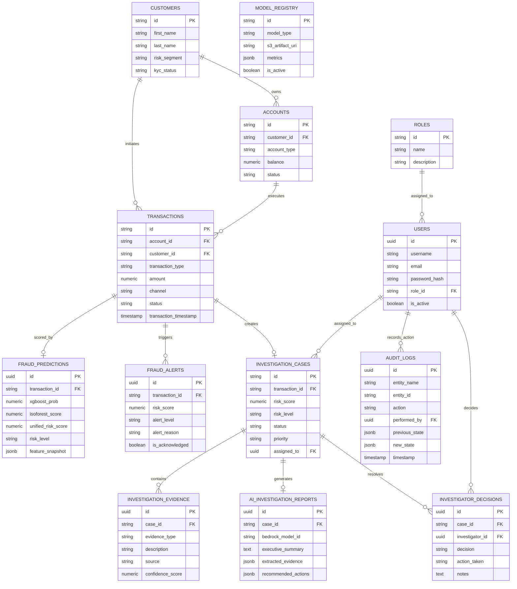

# FinGuard AI — Entity-Relationship (ER) Diagram

## 1. Relational Architecture Diagram

---

## 2. Referential Integrity & Cascade Semantics
- **`accounts` -> `customers`:** Cascade delete on customer removal in test environments.
- **`transactions` -> `accounts`:** Restrict delete to prevent orphan financial records.
- **`investigation_cases` -> `transactions`:** 1-to-1 relationship enforced via unique constraint.
- **`investigator_decisions` -> `investigation_cases`:** Append-only history preserving multi-tier reviews.
- **`audit_logs`:** No cascade deletion; append-only compliance structure.

