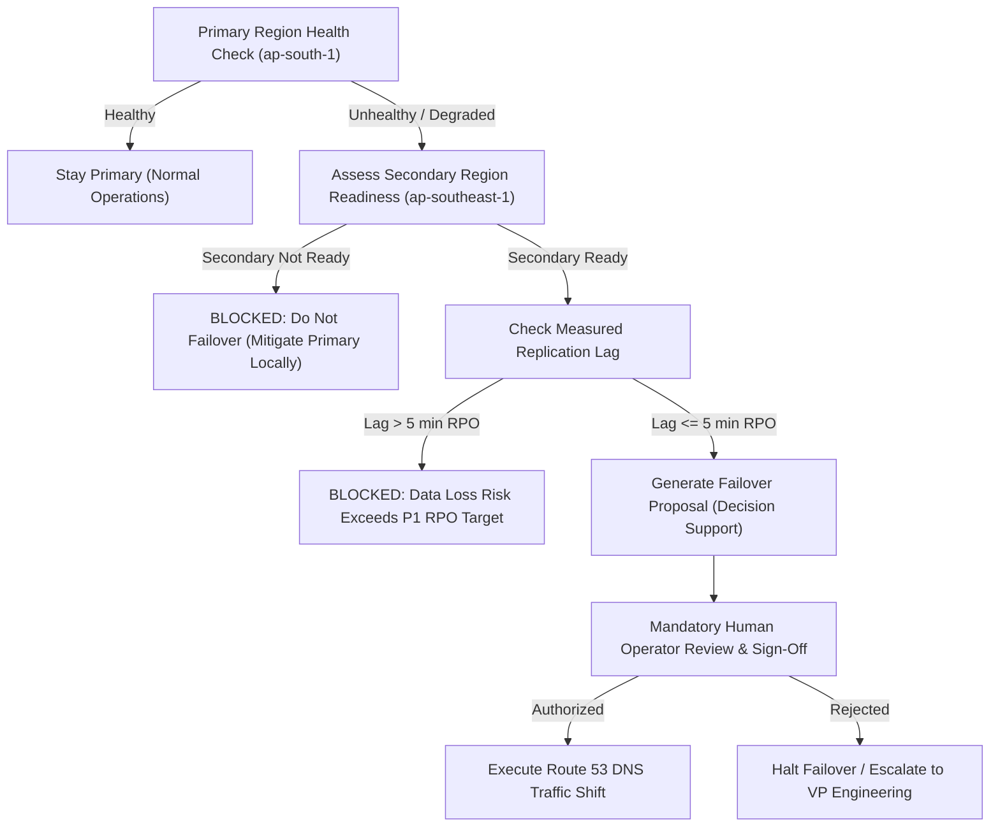

# FinGuard AI — Disaster Recovery Failover & Business Continuity Runbook

This runbook establishes deterministic Standard Operating Procedures (SOPs) for evaluating regional health, generating failover proposals, enforcing human operator authorization, and executing Route 53 DNS shift and failback.

---

## 1. Multi-Region Architecture Topology

| Role | Region | Components | Replication Mechanism |
| :--- | :--- | :--- | :--- |
| **Primary** | Mumbai (`ap-south-1`) | Active EKS, DynamoDB, S3, RDS Multi-AZ | Active write leader |
| **Secondary (DR)** | Singapore (`ap-southeast-1`) | Warm Standby EKS, DynamoDB Global Table / Replica, S3 Replica | S3 CRR, DynamoDB Global Tables |

---

## 2. Emergency Failover Decision Tree



---

## 3. Step-by-Step Operator Procedures

### Step 1: Automated Health & Lag Assessment
Run the FinGuard DR CLI:
```bash
python scripts/assess_dr.py failover-plan --secondary-ready --lag 2.0
```
Ensure the engine outputs `Recommended Action: EXECUTE_FAILOVER` and `Approved by Engine: YES`.

### Step 2: Human Operator Authorization Gate
Confirm the following checklist before authorising DNS traffic shift:
- [ ] AWS Personal Health Dashboard confirms multi-AZ outage or critical regional degradation in Mumbai (`ap-south-1`).
- [ ] Secondary EKS cluster pods in Singapore report `Running` and passing readiness probes.
- [ ] S3 Cross-Region Replication backlog is under 5 minutes.
- [ ] Incident Commander and SRE Lead have signed off on the execution proposal.

### Step 3: Route 53 DNS Failover Execution
1. Update DNS routing policy to shift API Gateway traffic from Mumbai to Singapore:
   ```bash
   aws route53 change-resource-record-sets \
     --hosted-zone-id Z123456FINGUARD \
     --change-batch file://infrastructure/route53/failover-to-singapore.json
   ```
2. Promote secondary databases to read-write leaders if running Aurora PostgreSQL Global Databases.

### Step 4: Verification & Smoke Testing
1. Execute synthetic smoke tests against the secondary endpoint:
   ```bash
   curl -fk https://api.singapore.finguard.internal/health
   curl -fk https://api.singapore.finguard.internal/dr/health
   ```
2. Verify live transaction throughput resumes in the SRE Grafana Console.

---

## 4. Controlled Failback Procedure (Restoring Mumbai)

Once AWS confirms normal regional operations in Mumbai (`ap-south-1`):
1. **Quiesce Non-Critical Ingestion**: Pause batch asynchronous workers in Singapore.
2. **Reverse Replication Sync**: Ensure reverse S3 and DynamoDB replication from Singapore to Mumbai catches up to 0 seconds lag.
3. **Verify Mumbai EKS Pods**: Re-scale deployments in Mumbai and confirm health checks pass.
4. **Shift DNS**: Switch Route 53 primary routing back to Mumbai.
5. **Post-Mortem**: Document incident chronology, total recovery time (RTO), and observed data loss (RPO).
