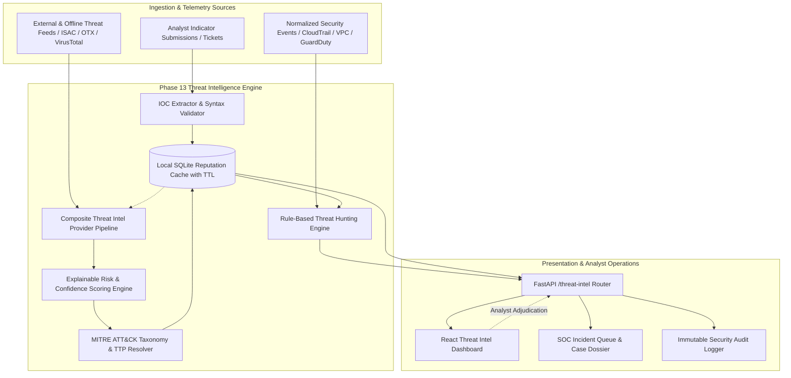

# Phase 13 — Enterprise Threat Intelligence Platform, IOC Enrichment, Threat Hunting and MITRE ATT&CK Mapping

## 1. Executive Summary

Phase 13 establishes the **Threat Intelligence and Proactive Threat Hunting Layer** for FinGuard AI. While Phase 12 provides centralized incident response and security orchestration (SOC), modern financial institutions face advanced persistent threats (APTs), organized cyber syndicates, distributed credential stuffing attacks, and banking malware campaigns that leverage dynamic infrastructure.

This phase equips FinGuard AI with:
1. **Multi-Type IOC Extraction & Validation:** Automated syntax classification and normalization for IPv4, domains, URLs, MD5, SHA-1, and SHA-256 indicators.
2. **Pluggable Intelligence Provider Adapters:** A composite provider pipeline supporting offline high-fidelity threat fixtures and live reputation feeds (OTX, AbuseIPDB, VirusTotal schemas).
3. **Local SQLite Reputation Cache with TTL:** High-throughput caching of indicators to minimize external API costs and latency, with automated expiration and eviction.
4. **Explainable Risk & Confidence Scoring:** Deterministic formulation combining base reputation, feed corroboration, threat categories (C2, ransomware, credential theft), and analyst feedback.
5. **MITRE ATT&CK Enterprise Mapping:** Direct alignment of threat indicators and security findings with ATT&CK tactics, techniques, and procedures (TTPs).
6. **Hypothesis-Driven Threat Hunting:** Configurable rule evaluation across normalized security telemetry (CloudTrail, VPC Flow, GuardDuty, fraud events).
7. **Human-in-the-Loop Analyst Adjudication:** Analysts validate leads, mark true/false positives, and calibrate indicator confidence without automated over-blocking.
8. **React Threat Intelligence Workspace:** Analyst dashboard for indicator exploration, on-demand enrichment, active threat hunting, and ATT&CK navigation.
9. **Encrypted S3 & KMS Infrastructure:** Terraform module provisioning a customer-managed KMS key and S3 lifecycle archive for threat telemetry.

---

## 2. System Architecture

---

## 3. IOC Extraction & Validation Specification

The indicator extraction engine supports 6 atomic IOC types:

| IOC Type | Syntax Validation Standard | Normalization Format | Example |
| :--- | :--- | :--- | :--- |
| `IPV4` | RFC 791 dotted decimal (`0.0.0.0` - `255.255.255.255`) | Canonical dotted decimal | `198.51.100.42` |
| `DOMAIN` | RFC 1035 / RFC 1123 fully qualified domain name | Lowercase, trimmed | `evil-bank-login.com` |
| `URL` | RFC 3986 with scheme (`http://` or `https://`) and netloc | Trimmed, stripped trailing slash | `https://secure-update-verify.net/auth` |
| `MD5` | 32-character hexadecimal string | Lowercase | `44d88612fea8a8f36de82e1278abb02f` |
| `SHA1` | 40-character hexadecimal string | Lowercase | `da39a3ee5e6b4b0d3255bfef95601890afd80709` |
| `SHA256`| 64-character hexadecimal string | Lowercase | `e3b0c44298fc1c149afbf4c8996fb92427ae...` |

Unstructured text scanning utilizes pre-compiled regex tokens to extract indicators embedded in alert summaries, emails, and ticket descriptions without false-positive collision.

---

## 4. Explainable Risk & Confidence Scoring Formulation

An IOC match is an operational lead, not proof of guilt. The scoring model computes a continuous reputation score $R \in [0.0, 100.0]$ and confidence $C \in [0.0, 1.0]$:

### 4.1 Scoring Formulation
1. **Base Reputation ($R_{\text{base}}$):** Derived from authoritative provider consensus.
2. **Feed Corroboration ($N_{\text{feeds}}$):**
   $$C = \min\left(1.0, C_{\text{base}} + 0.05 \times (N_{\text{feeds}} - 1)\right)$$
3. **Critical Threat Multiplier:** If threat types include C2, Ransomware, Credential Theft, or Botnet:
   $$R = \min(100.0, R + 10.0)$$
4. **Analyst Feedback Calibration (Human-in-the-Loop):**
   - **False Positive:** $R \leftarrow 0.0$, $C \leftarrow 1.0$, $\text{Status} \leftarrow \text{REVOKED}$.
   - **Benign:** $R \leftarrow R \times 0.1$, $\text{Status} \leftarrow \text{REVOKED}$.
   - **True Positive:** $R \leftarrow \min(100.0, \max(85.0, R + 15.0))$, $C \leftarrow 1.0$, $\text{Status} \leftarrow \text{ACTIVE}$.
   - **Suspicious:** $R \leftarrow \min(100.0, R + 10.0)$, $\text{Status} \leftarrow \text{UNDER\_REVIEW}$.
5. **Time Decay / Expiry:** If current timestamp exceeds `expires_at`:
   $$R \leftarrow R \times 0.5, \quad \text{Status} \leftarrow \text{EXPIRED}$$

### 4.2 Severity Categorization
- **CRITICAL** ($R \ge 85.0$): Confirmed active malicious infrastructure; automated alert escalation.
- **HIGH** ($65.0 \le R < 85.0$): Known suspicious node or proxy; targeted investigation required.
- **MEDIUM** ($40.0 \le R < 65.0$): Low-confidence or legacy threat indicator.
- **LOW** ($15.0 \le R < 40.0$): Scanner or generic web crawler.
- **INFO** ($R < 15.0$): Unclassified or benign telemetry lead.

---

## 5. MITRE ATT&CK Matrix Mapping

The platform aligns indicators with MITRE Enterprise ATT&CK:

| Technique ID | Name | Primary Tactic | Associated Threat Categories |
| :--- | :--- | :--- | :--- |
| **`T1078`** | Valid Accounts | Initial Access, Defense Evasion | Account Takeover, Synthetic Identity |
| **`T1110`** | Brute Force | Credential Access | Credential Stuffing, Password Spraying |
| **`T1071`** | Application Layer Protocol | Command and Control | C2 Beacons, Botnet Traffic |
| **`T1566`** | Phishing | Initial Access | Deceptive Domains, Credential Harvesters |
| **`T1090`** | Proxy | Command and Control | Tor Exit Nodes, VPN Anonymizers |
| **`T1567`** | Exfiltration Over Web Service | Exfiltration | Data Theft to Cloud Storage |
| **`T1589`** | Gather Victim Identity Info | Reconnaissance | Synthetic Identity Personas |
| **`T1539`** | Steal Web Session Cookie | Credential Access | MFA Token Hijacking |
| **`T1059`** | Command and Scripting Interpreter | Execution | Malware Droppers, Shellcode |
| **`T1486`** | Data Encrypted for Impact | Impact | Ransomware Payloads |

---

## 6. Threat Hunting Rules Specification

Hunting rules evaluate structured predicates over normalized security events:
- **`HUNT-RULE-001` (C2 Traffic to Known Proxy Nodes):** Evaluates `matches_ioc` on `source_ip` or `details.source_ip` against active C2 indicators ($R \ge 50.0$), mapped to `T1071`.
- **`HUNT-RULE-002` (Credential Access & Brute Force):** Evaluates `event_type contains "Credential"` or `"BruteForce"` or `details.type contains "AnomalousBehavior"`, mapped to `T1110`.
- **`HUNT-RULE-003` (Phishing Infrastructure & Lookalike Domains):** Evaluates `matches_ioc` on `domain` or `url`, mapped to `T1566`.

---

## 7. API Reference

All routes are mounted under `/threat-intel` in `api/app.py` and enforce Cognito RBAC:

| Method | Route | Permission / Role | Description |
| :--- | :--- | :--- | :--- |
| `GET` | `/threat-intel/iocs` | `cases:view` | Lists cached indicators with type, severity, and score filters |
| `GET` | `/threat-intel/iocs/{ioc_id}` | `cases:view` | Retrieves full indicator dossier and review history |
| `POST` | `/threat-intel/enrich` | `cases:view` | Enriches list of indicators via provider adapters and cache |
| `GET` | `/threat-intel/rules` | `cases:view` | Lists registered threat hunting rules |
| `POST` | `/threat-intel/hunt` | `Admin`, `Investigator`, `Analyst` | Executes hunting campaign across provided events |
| `POST` | `/threat-intel/feedback` | `Admin`, `Investigator` | Submits human analyst verdict and recalibrates risk score |
| `GET` | `/threat-intel/mitre` | `cases:view` | Retrieves MITRE ATT&CK taxonomy and technique catalog |

---

## 8. Verification & Demonstration Evidence

1. **Python Unit & Integration Test Suite (`tests/phase13/test_threat_intel.py`):**
   - **Result:** `11/11 passed` in 12.78s (100% success rate).
2. **IOC Enrichment CLI Demo (`scripts/enrich_iocs.py`):**
   - **Result:** `4 indicators processed`, saved to `artifacts/phase13/enriched-iocs.json`.
3. **Threat Hunting CLI Demo (`scripts/hunt_events.py`):**
   - **Result:** `2 matches found` across 4 security events, saved to `artifacts/phase13/hunt-results.json`.
4. **Frontend TypeScript & Production Build:**
   - **Result:** `tsc --noEmit` (0 errors) and `vite build` completed cleanly (`dist/` generated).
5. **Full System Regression Suite:**
   - **Result:** 11 passed in Phase 15, 25 passed in Phase 10/12 (0 regressions).
