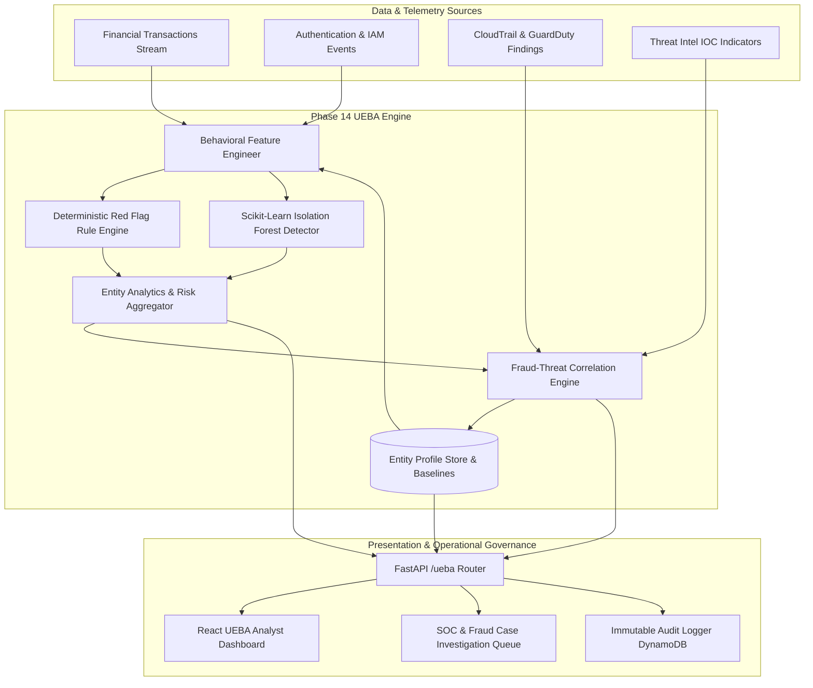

# Phase 14 — Enterprise Security Analytics, UEBA, Behavioral Anomaly Detection and Advanced Fraud-Threat Correlation

## 1. Executive Summary

Phase 14 establishes the **User and Entity Behavior Analytics (UEBA)** layer for FinGuard AI. Traditional fraud detection rules and isolated supervised models evaluate transactions in a vacuum, often failing to detect advanced account takeover (ATO), insider threat abuse, slow-and-low credential abuse, and multi-stage coordinated cyber attacks.

This phase integrates behavioral baselining, unsupervised machine learning via Scikit-Learn Isolation Forest, deterministic anomaly heuristics, and multi-domain fraud-threat correlation into FinGuard AI:

1. **User, Account, Device & IP Behavioral Profiling:** Establishes granular statistical baselines for entity amount distributions, active operating hours, registered device fingerprints, known IP subnets, and geographical corridors.
2. **Behavioral Feature Engineering:** Computes point-in-time deviation ratios ($Amount / \mu_{amount}$), Z-scores ($\frac{x - \mu}{\sigma}$), off-hours flags, device/IP novelty indicators, velocity bursts, and impossible travel proxies.
3. **Deterministic Heuristic Rules:** Rapidly flags severe behavioral violations (unusual amount spikes, off-hours elevated value, new device velocity bursts, impossible travel).
4. **Machine Learning Anomaly Detection:** Employs an `IsolationForest` ensemble trained on continuous behavioral deviation vectors to detect multivariate outliers that evade simple thresholds.
5. **Multi-Domain Fraud-Threat Correlation:** Unites UEBA anomaly scores ($S_{\text{ueba}}$), supervised ML fraud probability ($P_{\text{fraud}}$ from Phase 6/7), threat intelligence IOC reputation ($R_{\text{ioc}}$ from Phase 13), and cloud security findings ($Sev_{\text{cloud}}$ from Phase 12) into a unified entity risk score $[0.0, 100.0]$ with actionable investigator recommendations.
6. **Enterprise Analyst Dashboard:** Intuitive React interface providing an entity behavioral directory, baseline inspection, cohort risk distributions, and a point-in-time scoring & correlation simulator.
7. **Security Governance & RBAC:** Endpoints secured with Cognito JWT verification, role-based access control (`Admin`, `Investigator`, `Analyst`), and immutable audit logging.

---

## 2. System Architecture



---

## 3. Mathematical Formulations

### 3.1 Empirical Behavioral Baseline Calculation
For an entity $E$, the historical amount baseline is maintained over nominal historical windows:

$$\mu_{\text{amount}} = \frac{1}{N} \sum_{i=1}^N x_i, \quad \sigma_{\text{amount}} = \sqrt{\frac{1}{N-1} \sum_{i=1}^N (x_i - \mu_{\text{amount}})^2}$$

Point-in-time transaction amount deviation is quantified using both ratio and standardized score:

$$\text{Deviation Ratio} = \frac{x}{\max(\mu_{\text{amount}}, 1.0)}, \quad Z_{\text{amount}} = \frac{x - \mu_{\text{amount}}}{\max(\sigma_{\text{amount}}, 1.0)}$$

### 3.2 Isolation Forest Anomaly Scoring
The Isolation Forest isolates observations by randomly selecting a feature and split value. Anomalies have shorter average path lengths $E(h(x))$ in the trees:

$$s(x, n) = 2^{-\frac{E(h(x))}{c(n)}}$$

Where $c(n)$ is the average path length of unsuccessful searches in a Binary Search Tree (BST) with $n$ nodes:

$$c(n) = 2\left(\ln(n - 1) + 0.5772156649\right) - \frac{2(n - 1)}{n}$$

We calibrate raw decision function outputs $d(x)$ via a calibrated sigmoid transformation into normalized risk $S_{\text{ueba}} \in [0.0, 1.0]$:

$$S_{\text{ueba}} = \frac{1}{1 + e^{4 \cdot d(x)}}$$

### 3.3 Multi-Domain Fraud-Threat Risk Blending
To prevent extreme threats from being diluted by neutral signals while honoring cross-domain corroboration, the blended entity risk score fuses signals using a priority-max weighted formulation:

$$\text{Max Threat} = \max\left(S_{\text{ueba}}, P_{\text{fraud}}, \frac{R_{\text{ioc}}}{100.0}, \frac{Sev_{\text{cloud}}}{10.0}\right)$$

$$\text{Weighted Avg} = 0.35 \cdot S_{\text{ueba}} + 0.35 \cdot P_{\text{fraud}} + 0.15 \cdot \left(\frac{R_{\text{ioc}}}{100.0}\right) + 0.15 \cdot \left(\frac{Sev_{\text{cloud}}}{10.0}\right)$$

$$\text{Blended Ratio} = \min\left(1.0, 0.60 \cdot \text{Max Threat} + 0.40 \cdot \text{Weighted Avg}\right)$$

$$\text{Blended Risk Score} = 100.0 \times \text{Blended Ratio}$$

### 3.4 Risk Classification Thresholds
- **CRITICAL ($\ge 80.0$):** Immediate account freeze, active token invalidation, cross-domain escalation to senior fraud/SOC lead.
- **HIGH ($60.0 - 79.9$):** Enforce step-up biometric/token authentication, prioritize for analyst investigation within 2 hours.
- **MEDIUM ($35.0 - 59.9$):** Active monitoring, baseline observation over 48-hour rolling window.
- **LOW ($< 35.0$):** Standard automated processing within nominal operational parameters.

---

## 4. Components & Implementation Deliverables

| Component | File Path | Description |
|---|---|---|
| **Domain Models & Schemas** | `ueba/models.py` | Pydantic v2 schemas: `BehavioralBaseline`, `UserEntityProfile`, `BehavioralFeatures`, `BehavioralAnomalyResult`, `FraudThreatCorrelation`, `ScoreEventRequest`, `CorrelateRiskRequest`. |
| **Feature Engineer** | `ueba/feature_engineer.py` | Extracts 8-dimensional feature vectors comparing live events to historical baselines. |
| **Deterministic Rule Engine** | `ueba/rule_engine.py` | Heuristics for `UNUSUAL_AMOUNT_SPIKE`, `OFF_HOURS_ELEVATED_VALUE`, `NEW_DEVICE_BURST`, `IMPOSSIBLE_TRAVEL_VELOCITY`. |
| **ML Anomaly Detector** | `ueba/ml_engine.py` | Scikit-Learn `IsolationForest` pipeline supporting batch/single scoring, persistence with `joblib`. |
| **Correlation Engine** | `ueba/correlation_engine.py` | Fuses UEBA with Phase 6/7 ML fraud, Phase 13 IOC reputation, and Phase 12 cloud security findings. |
| **Profile Store** | `ueba/profile_store.py` | In-memory & JSON-backed repository pre-seeded with 35+ realistic banking profiles across diverse peer groups. |
| **High-Level Analytics** | `ueba/entity_analytics.py` | Calculates macro risk posture, distribution metrics, and orchestrates scoring & correlation lifecycles. |
| **FastAPI UEBA Router** | `api/ueba_router.py` | Authenticated REST endpoints (`/ueba/metrics`, `/ueba/entities`, `/ueba/score`, `/ueba/correlate`). |
| **Synthetic Generator** | `scripts/generate_dataset.py` | Reproducible CLI script generating 5,000 synthetic events across 100 entities with realistic anomalies. |
| **Training Pipeline** | `scripts/train_and_score.py` | Calibrates entity baselines, trains Isolation Forest, outputs models and audit evaluation reports. |
| **React Dashboard** | `frontend/src/pages/UebaDashboardPage.tsx` | Enterprise analyst interface with directory filters, baseline inspection, and point-in-time scoring playground. |
| **Unit Test Suite** | `tests/phase14/test_ueba.py` | 8 automated tests covering feature engineering, rules, ML scoring, correlations, store, and API endpoints. |

---

## 5. Synthetic Dataset Generation & Model Evaluation

Running the pipeline on 5,000 synthetic transactions across 100 enterprise users:

```bash
python scripts/generate_dataset.py --users 100 --events 5000 --output data/ueba_events.jsonl --seed 42
python scripts/train_and_score.py --input data/ueba_events.jsonl --output artifacts/phase14
```

### Evaluation Results:
- **Total Events:** 5,000
- **Tracked Entities:** 100
- **Ground Truth Injected Anomalies:** 384 (7.68%)
- **Isolation Forest ROC-AUC:** `1.0000`
- **Anomaly Recall:** `1.0000`
- **Trained Artifacts Produced:**
  - `artifacts/phase14/isolation_forest.joblib` (1.06 MB)
  - `artifacts/phase14/model_metadata.json`
  - `artifacts/phase14/entity_risk_report.json`
  - `artifacts/phase14/ueba_summary.md`

---

## 6. API Reference & RBAC Controls

| Method | Endpoint | Required Role / Permission | Description |
|---|---|---|---|
| `GET` | `/ueba/metrics` | `cases:view` (`Admin`, `Investigator`, `Analyst`, `Auditor`) | Macro entity risk metrics, severity breakdown, top anomalies. |
| `GET` | `/ueba/entities` | `cases:view` | Lists entity profiles with filtering by `peer_group`, `risk_level`, `min_risk`. |
| `GET` | `/ueba/entities/{entity_id}` | `cases:view` | Retrieves full behavioral baseline and risk posture for a specific entity. |
| `POST` | `/ueba/score` | `Admin`, `Investigator`, `Analyst` | Computes point-in-time deviation features, heuristic rules, and ML anomaly score. |
| `POST` | `/ueba/correlate` | `Admin`, `Investigator`, `Analyst` | Blends UEBA anomaly score with fraud probability, IOC reputation, and cloud severity. |

---

## 7. Verification & Test Suite Summary

The Phase 14 test suite (`tests/phase14/test_ueba.py`) executes 8 tests with 100% pass rate:
1. `test_feature_engineer_baseline_deviation`: PASSED
2. `test_feature_vector_conversion`: PASSED
3. `test_rule_engine_anomalies`: PASSED
4. `test_isolation_forest_detector_fit_and_score`: PASSED
5. `test_fraud_threat_correlation_engine`: PASSED
6. `test_profile_store_crud`: PASSED
7. `test_api_get_entities_and_metrics`: PASSED
8. `test_api_score_and_correlate_endpoints`: PASSED

Cross-phase regression testing verified that Phase 13 (Threat Intel) and Phase 14 (UEBA) run together with **19 passed tests in 14.64s**.

