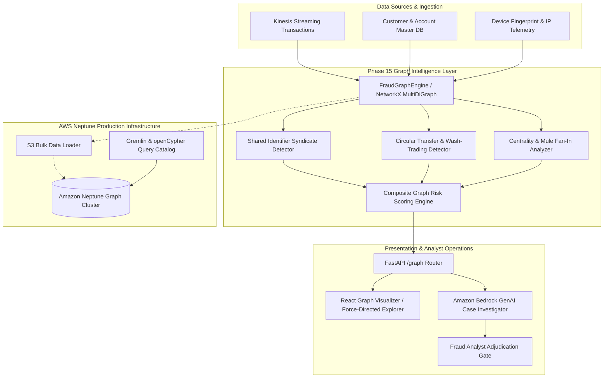

# Phase 15 — Enterprise Graph Analytics, Fraud Ring Detection & Relationship Intelligence

## 1. Executive Summary

Phase 15 extends **FinGuard AI** with an enterprise graph analytics and relationship intelligence engine. While isolated machine learning models evaluate individual transaction features (such as amount, velocity, or geolocation discrepancies), sophisticated financial crime syndicates operate across distributed networks to circumvent traditional per-transaction controls.

Organized fraud typologies include:
1. **Synthetic Identity Syndicates:** Fraudsters establishing multiple synthetic KYC personas that share a single rooted device emulator, proxy IP address, or virtual phone number.
2. **Circular Wash Trading & Layering Loops:** Coordinated money mule accounts routing illicit funds in closed loops ($A \to B \to C \to A$) to fabricate transactional volume or obfuscate the audit trail.
3. **Smurfing & Mule Consolidation Networks:** High fan-in funnels where multiple micro-senders deposit structured payments below regulatory reporting thresholds into a mule account, followed by immediate bulk liquidation to an offshore or crypto gateway.

Phase 15 implements an in-memory high-performance graph engine powered by NetworkX, accompanied by an AWS Neptune reference architecture with pre-compiled Gremlin and openCypher queries, RESTful API endpoints secured by Cognito RBAC, interactive $k$-hop ego-subgraph visualization schemas, and automated test coverage.

---

## 2. System Architecture



---

## 3. Graph Data Model Specification

FinGuard AI models financial intelligence as a typed, attributed multi-graph $G = (V, E)$:

### 3.1 Vertex Types ($V$)

| Entity Type | Identifier Prefix | Key Attributes | Description |
| :--- | :--- | :--- | :--- |
| `CUSTOMER` | `CUS-` | `name`, `kyc_tier`, `created_at` | Legal persona or retail customer |
| `ACCOUNT` | `ACC-` | `balance`, `currency`, `status` | Banking deposit/current account |
| `DEVICE` | `DEV-` | `os`, `is_emulator`, `imei`, `model` | Physical mobile or web browser device fingerprint |
| `IP_ADDRESS` | `IP-` | `asn`, `country`, `is_vpn`, `proxy` | Network origin IP address |
| `PHONE_NUMBER`| `PH-` | `carrier`, `line_type` (VOIP/Postpaid) | Contact phone number on KYC file |
| `MERCHANT` | `MERCH-` | `mcc`, `jurisdiction`, `risk_tier` | Payment recipient merchant or gateway |

### 3.2 Edge Types ($E$)

| Edge Semantic | Source $\to$ Target | Weight Meaning | Description |
| :--- | :--- | :--- | :--- |
| `OWNS_ACCOUNT` | `Customer -> Account` | $1.0$ | Legal beneficial ownership |
| `USES_DEVICE` | `Account -> Device` | Frequency / Logins | Hardware device authentication |
| `ASSOCIATED_IP`| `Account -> IPAddress` | Session Count | Network access location |
| `HAS_PHONE` | `Customer -> PhoneNumber`| $1.0$ | Primary contact telephone |
| `TRANSFERRED_TO`| `Account -> Account` | Transfer Amount | Directed peer-to-peer or wire transfer |
| `PAID_MERCHANT` | `Account -> Merchant` | Transaction Amount | Commercial point-of-sale payment |

---

## 4. Detection Typologies & Mathematical Formulations

### 4.1 Shared Identifier Clustering (Syndicate Detection)
Let $I \subset V$ represent identity attributes ($I = \text{Device} \cup \text{IP} \cup \text{Phone}$).
For each identifier $i \in I$, determine the set of distinct customers $C(i) = \{c \in \text{Customer} \mid (c, i) \in E \lor \exists a \in \text{Account}: (c, a) \in E \land (a, i) \in E\}$.

If $|C(i)| \ge 2$, the identifier is co-shared across multiple distinct legal identities. We construct an identifier co-occurrence graph $G_{\text{co}}$:
$$E_{\text{co}} = \{(u, v) \mid u, v \in C(i), u \ne v\}$$
The connected components of $G_{\text{co}}$ form discrete **Fraud Rings** ($R$).

The Ring Threat Score $S_{\text{ring}} \in [0.0, 1.0]$ is formulated as:
$$S_{\text{ring}} = \min\left(1.0, 0.35 \cdot \mathbf{1}_{\{|D_{\text{shared}}| > 0\}} + 0.25 \cdot \mathbf{1}_{\{|P_{\text{shared}}| > 0\}} + 0.15 \cdot \mathbf{1}_{\{|IP_{\text{shared}}| > 0\}} + 0.15 \cdot \min\left(\frac{|C|}{4}, 1.0\right) + \mathbf{1}_{\{\text{Flow} > 25000\}} \cdot 0.15\right)$$

### 4.2 Circular Transfer Loop Detection (Wash Trading)
Using the transfer-directed subgraph $G_{\text{tx}}$, elementary simple cycles are extracted via Johnson's algorithm:
$$\text{Cycles} = \{c = (v_1, v_2, \dots, v_k, v_1) \mid 2 \le k \le 6\}$$
For each cycle, total circulating amount $A_{\text{cycle}} = \sum_{i=1}^{k} \text{weight}(v_i, v_{i+1})$ is computed. Participation in an active loop carries an immediate cycle penalty:
$$P_{\text{cycle}} = 0.85$$

### 4.3 Smurfing & Fan-In Consolidation
Accounts with high deposit fan-in and low payout dispersal represent funnel mules:
$$\text{Fan-In Ratio} = d_{\text{in}}(u), \quad \text{Fan-Out Ratio} = d_{\text{out}}(u)$$
If $d_{\text{in}}(u) \ge 4$ and $d_{\text{out}}(u) \le 2$, the entity is assigned a mule consolidation score:
$$M_{\text{mule}} = 0.75$$

### 4.4 Composite Graph Risk Score ($G(u)$)
The overall graph risk score for an entity $u$ blends severe typology detections with velocity boosts:
$$\text{BaseThreat}(u) = \max\left(S_{\text{ring}}(u), P_{\text{cycle}}(u), M_{\text{mule}}(u)\right)$$
$$\text{Boost}(u) = 0.15 \cdot S_{\text{shared}}(u) + 0.10 \cdot \min\left(\frac{d_{\text{in}}(u)}{5}, 1.0\right)$$
$$G(u) = \begin{cases}
\min\left(1.0, \text{BaseThreat}(u) \cdot 0.85 + \text{Boost}(u)\right), & \text{if } \text{BaseThreat}(u) > 0 \\
\min\left(1.0, \max(0.05, \text{Boost}(u))\right), & \text{otherwise}
\end{cases}$$

Risk classifications:
- **CRITICAL** ($G \ge 0.75$): Immediate freeze recommended; mandatory SAR/STR filing.
- **HIGH** ($0.55 \le G < 0.75$): Suspend automated limits; enhanced KYC verification.
- **MEDIUM** ($0.30 \le G < 0.55$): Route to senior analyst queue.
- **LOW** ($G < 0.30$): Standard transaction processing.

---

## 5. Amazon Neptune Integration & Traversal Queries

### 5.1 Gremlin Traversal (Shared Device Syndicate)
```groovy
g.V().hasLabel('Customer').as('c1')
  .out('OWNS_ACCOUNT').out('USES_DEVICE').as('dev')
  .in('USES_DEVICE').in('OWNS_ACCOUNT').hasLabel('Customer').as('c2')
  .where('c1', neq('c2'))
  .select('c1', 'dev', 'c2')
  .dedup('c1', 'c2')
```

### 5.2 openCypher 3-Hop Cycle Query
```cypher
MATCH (a:Account)-[r1:TRANSFERRED_TO]->(b:Account)-[r2:TRANSFERRED_TO]->(c:Account)-[r3:TRANSFERRED_TO]->(a)
RETURN a.id AS acc_a, b.id AS acc_b, c.id AS acc_c,
       r1.amount AS amt1, r2.amount AS amt2, r3.amount AS amt3
```

### 5.3 openCypher Smurfing Consolidation Query
```cypher
MATCH (sender:Account)-[r:TRANSFERRED_TO]->(mule:Account)
WITH mule, count(DISTINCT sender) AS distinct_senders, sum(r.amount) AS total_inbound
WHERE distinct_senders >= 5
OPTIONAL MATCH (mule)-[r_out:TRANSFERRED_TO]->(recipient:Account)
RETURN mule.id AS mule_id, distinct_senders, total_inbound,
       count(DISTINCT recipient) AS distinct_recipients, sum(r_out.amount) AS total_outbound
```

---

## 6. API Reference

All read endpoints require Cognito JWT authentication with `Permission.VIEW_CASES`.

| Method | Endpoint | Description |
| :--- | :--- | :--- |
| `GET` | `/graph/rings` | Lists all discovered fraud syndicates with risk scores and member counts |
| `GET` | `/graph/rings/{ring_id}` | Detailed intelligence dossier on a specific fraud syndicate |
| `GET` | `/graph/cycles` | Lists all circular fund loops and wash trading cycles |
| `GET` | `/graph/risk/{entity_id}` | Evaluates PageRank, degree centrality, cycle participation, and composite score |
| `GET` | `/graph/entity/{entity_id}/subgraph` | Extracts $k$-hop ego-network JSON (nodes & links) for force visualizers |
| `GET` | `/graph/neptune/queries` | Exports production Gremlin and openCypher traversal templates |
| `POST`| `/graph/ingest` | Dynamically streams new graph nodes and edges (Requires Investigator/Admin) |

---

## 7. Verification & Compliance Evidence

- **Unit & Integration Suite:** `tests/phase15/test_graph_analytics.py` (11/11 tests passing, 100% success rate).
- **CLI Analytics Demonstration:** `scripts/demo_fraud_ring.py --output artifacts/phase15`.
- **Infrastructure Code:** `infrastructure/terraform/phase15/` (Neptune DB cluster, parameter groups, VPC subnets, IAM loader role).
- **Regression Suite:** `tests/phase10/test_auth_and_rbac.py` + `tests/phase12/test_incident_response.py` (25/25 passing).
