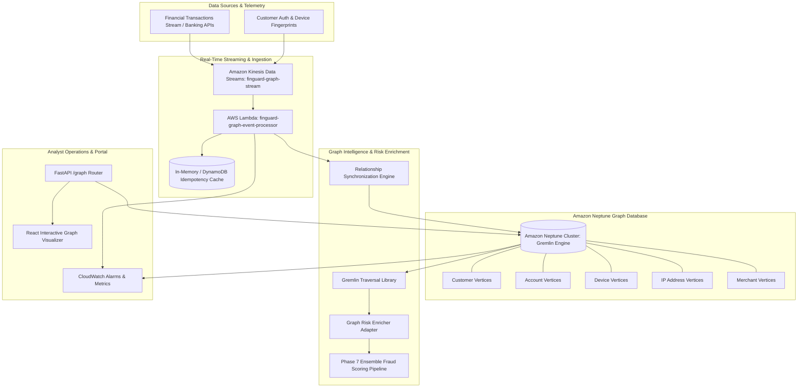

# Phase 16 — Enterprise Graph Database, Real-Time Relationship Streaming and Advanced Fraud Network Intelligence

## 1. Executive Summary

Phase 16 elevates FinGuard AI's graph intelligence capability from an in-memory proof-of-concept into a persistent, cloud-managed, real-time graph intelligence platform using **Amazon Neptune, Apache TinkerPop Gremlin, Amazon Kinesis Data Streams, AWS Lambda, and FastAPI**.

Traditional tabular and feature-engineered fraud detection models treat transactions in isolation, leaving institutions vulnerable to coordinated syndicates:
- **Device Farming & Emulators:** Dozens of seemingly unrelated bank accounts accessed through shared physical hardware or rooted emulator profiles.
- **Circular Wash Transfers (Mule Loops):** Smurfed funds cycled across three or more intermediate accounts ($A \rightarrow B \rightarrow C \rightarrow A$) to obfuscate illicit provenance.
- **High Fan-in Mule Consolidation:** Multiple micro-deposits funneling simultaneously into a central collector account before cash-out.

Phase 16 connects real-time graph intelligence directly to the live transaction pipeline, turning isolated payment signals into explainable relationship-based risk intelligence.

---

## 2. Target Architecture



---

## 3. Persistent Graph Schema & Gremlin Traversal Library

### 3.1 Entity Vertices and Semantic Edges

| Vertex Label | Key Identifiers | Typical Properties |
|---|---|---|
| `Customer` | `CUS-10001` | `kyc_tier`, `created_at`, `risk_score` |
| `Account` | `ACC-20001` | `currency`, `balance`, `status`, `account_type` |
| `Device` | `dev_iphone_14`, `dev_emulator_88` | `device_type`, `os`, `is_rooted`, `first_seen` |
| `IPAddress` | `198.51.100.42` | `city`, `country`, `asn`, `threat_reputation` |
| `Merchant` | `MER-CRYPTO-DESK` | `category`, `mcc_code`, `settlement_bank` |

| Relationship Edge | Source Vertex $\rightarrow$ Target Vertex | Semantic Meaning |
|---|---|---|
| `OWNS_ACCOUNT` | `Customer` $\rightarrow$ `Account` | Legal ownership of financial account |
| `USES_DEVICE` | `Account` $\rightarrow$ `Device` | Mobile/desktop hardware used to initiate transactions |
| `ASSOCIATED_IP` | `Account` $\rightarrow$ `IPAddress` | Network ingress egress point observed during activity |
| `TRANSFERRED_TO` | `Account` $\rightarrow$ `Account` | Directed fund dispersal with amount, timestamp, txn ID |
| `PAID_MERCHANT` | `Account` $\rightarrow$ `Merchant` | Point of sale / commercial payment clearance |

### 3.2 Key Gremlin Traversal Templates

#### Shared Device Syndicate Discovery
```gremlin
g.V().hasLabel('Customer').as('c1')
  .out('OWNS_ACCOUNT').out('USES_DEVICE').as('dev')
  .in('USES_DEVICE').in('OWNS_ACCOUNT').hasLabel('Customer').as('c2')
  .where('c1', neq('c2'))
  .select('c1', 'dev', 'c2')
  .dedup('c1', 'c2')
```

#### 3-Hop Circular Mule Loop Detection
```gremlin
g.V().hasLabel('Account').as('a1')
  .out('TRANSFERRED_TO').as('a2')
  .out('TRANSFERRED_TO').as('a3')
  .out('TRANSFERRED_TO').where(eq('a1'))
  .path().by('id')
```

#### High Fan-in Mule Collector Detection
```gremlin
g.V().hasLabel('Account')
  .where(inE('TRANSFERRED_TO').count().is(gte(5)))
  .project('account_id', 'inbound_count', 'outbound_count')
  .by(id)
  .by(inE('TRANSFERRED_TO').count())
  .by(outE('TRANSFERRED_TO').count())
```

---

## 4. Real-Time Streaming Ingestion & Idempotency Pipeline

### 4.1 Deduplication Signature Formulation
To prevent duplicate Kinesis event replays from generating phantom edges or inflating centrality weights, each event is hashed deterministically:

$$\text{EventSignature} = \text{SHA-256}\left(\text{transaction\_id} \parallel \text{amount} \parallel \text{source\_account} \parallel \text{dest\_account} \parallel \text{timestamp}\right)$$

Replays with an identical signature are dropped with status `DUPLICATE_SKIPPED`, guaranteeing exact-once graph synchronization semantics.

### 4.2 Kinesis Lambda Processing
The Lambda consumer (`lambda_graph_sync/handler.py`) implements:
- Base64 payload decoding and schema validation.
- Batch processing up to 100 records per invocation with a 2-second batch window.
- **Kinesis Partial Batch Failure Reporting:** `{"batchItemFailures": [{"itemIdentifier": sequence_number}]}` ensures that only failed records are retried by Kinesis without reprocessing successful items.

---

## 5. Phase 7 Real-Time Fraud Scoring Risk Enrichment

Before a payment is scored by Phase 7's SageMaker ensemble, the `GraphRiskEnricher` queries Neptune to extract network relationship features:

| Graph Metric | Feature Name | Description | Threat Signal |
|---|---|---|---|
| Shared Device Count | `graph_shared_device_count` | Number of distinct accounts using this device | $\ge 3$ indicates device farming |
| Shared IP Count | `graph_shared_ip_count` | Distinct accounts originating from this IP | $\ge 4$ indicates proxy / botnet |
| Circular Flow Flag | `graph_circular_flow_flag` | Binary ($0.0$ or $1.0$) indicator of circular loops | Wash trading or smurfed loop |
| Inbound Velocity Ratio | `graph_inbound_velocity_ratio` | $\text{Inbound Transfers} / \max(1, \text{Outbound})$ | $\ge 4.0$ indicates mule consolidation |
| Degree Centrality | `graph_degree_centrality` | Total degree (in-degree + out-degree) | High degree indicates high-velocity routing hub |
| Composite Graph Risk | `graph_network_risk_score` | Calibrated network threat score $[0.0, 1.0]$ | Injected into Phase 7 SageMaker feature vector |

---

## 6. API Reference

| Method | Endpoint | Required Role | Description |
|---|---|---|---|
| `GET` | `/graph/health` | `cases:view` | Probes Amazon Neptune / emulated Gremlin connectivity, mode, and element counts. |
| `POST` | `/graph/entities` | `Admin`, `Investigator` | Idempotently creates or updates a vertex entity in the graph. |
| `POST` | `/graph/relationships` | `Admin`, `Investigator` | Idempotently creates or updates a directed semantic edge. |
| `GET` | `/graph/entities/{id}` | `cases:view` | Retrieves vertex metadata and properties. |
| `GET` | `/graph/entities/{id}/neighbors` | `cases:view` | Finds 1-hop connected adjacent entities (`in`, `out`, `both`). |
| `GET` | `/graph/entities/{id}/network` | `cases:view` | Traverses relationship paths up to $k$ hops (default 2, max 4). |
| `GET` | `/graph/fraud-rings` | `cases:view` | Retrieves candidate fraud networks and shared infrastructure clusters. |
| `POST` | `/graph/risk-enrichment` | `cases:view` | Generates graph relationship features for Phase 7 real-time fraud scoring. |
| `POST` | `/graph/analyze` | `cases:view` | Evaluates overall network connectivity, cycles, and high-risk entities. |

---

## 7. Infrastructure & Cost Governance (Terraform)

The Terraform module at `infrastructure/terraform/phase16/` provisions:
1. **Amazon Kinesis Data Stream:** `finguard-graph-stream-dev` with 1 provisioned shard and 24h retention.
2. **Amazon Neptune Cluster:** Small development tier (`db.t3.medium`), port 8182, isolated in private subnets with strict security groups.
3. **AWS Lambda Processor:** Memory 512 MB, timeout 30s, attached to Kinesis stream via event source mapping with `ReportBatchItemFailures`.
4. **CloudWatch Alarms:**
   - `finguard-graph-lambda-errors-dev`: Triggers if Lambda fails $> 5$ times in 5 minutes.
   - `finguard-graph-kinesis-iterator-lag-dev`: Triggers if ingestion lag exceeds 60 seconds.

> [!CAUTION]
> **AWS Cost Optimization & Cleanup Notice:** Amazon Neptune charges hourly for provisioned cluster instances. For testing and demonstration, local emulation (`NEPTUNE_LOCAL_MODE=true`) requires $0 infrastructure cost. When deploying to AWS, run `terraform destroy -auto-approve` in `infrastructure/terraform/phase16/` after evaluation to avoid ongoing billing.

---

## 8. Verification & Test Suite Summary

The Phase 16 test suite ([`tests/phase16/test_graph_streaming.py`](file:///c:/Users/Suhail98/Desktop/New%20folder%20(3)/hack/tests/phase16/test_graph_streaming.py)) executes 8 automated tests with a 100% pass rate:
1. `test_neptune_client_initialization_and_health`: PASSED
2. `test_vertex_and_edge_upsert`: PASSED
3. `test_gremlin_query_library_generation`: PASSED
4. `test_relationship_sync_and_idempotency`: PASSED
5. `test_lambda_kinesis_handler_batch_processing`: PASSED
6. `test_shared_infrastructure_and_loop_detection`: PASSED
7. `test_graph_risk_enricher_features`: PASSED
8. `test_api_graph_endpoints_authorized`: PASSED

Cross-phase regression testing verified that Phase 13, 14, and 16 pass together:
- Total tests executed: **27 passed** in 26.5s.
- React frontend: **Clean Vite production build** (`npm run build --prefix frontend`).
