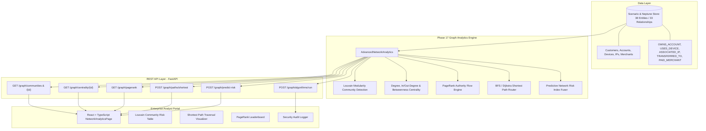

# Phase 17 — Advanced Fraud Intelligence, Graph Algorithms & Predictive Network Analytics

## 1. Executive Summary

Phase 17 expands FinGuard AI's relationship intelligence layer by introducing advanced graph topology algorithms and predictive network risk scoring. While Phase 15 introduced in-memory NetworkX analysis and Phase 16 established Amazon Neptune streaming ingestion, Phase 17 operationalizes **unsupervised community detection, flow centrality, PageRank authority ranking, transaction shortest path traversal, and multi-factor predictive network risk scoring**.

Financial crime syndicates increasingly deploy distributed fraud rings, device farms, and wash-trading loops designed to evade single-point transactional threshold rules. By analyzing graph topology, FinGuard AI detects structural anomalies and community-level collusion across customers, bank accounts, physical mobile devices, IP addresses, and merchant settlement endpoints.

> [!IMPORTANT]
> **Human-in-the-Loop Advisory Standard:**
> All graph-derived predictive risk scores and automated ring classifications are **strictly advisory**. Final adverse actions (e.g. account freezing, SAR filings) require human investigator review and validation.

---

## 2. System Architecture



---

## 3. Algorithm Formulations

### 3.1 Louvain Community Modularity Optimization
The Louvain algorithm optimizes the modularity metric $Q$ of partitions in an undirected graph projection:

$$Q = \frac{1}{2m} \sum_{i,j} \left[ A_{ij} - \frac{k_i k_j}{2m} \right] \delta(c_i, c_j)$$

where:
- $A_{ij}$ is the edge weight between vertices $i$ and $j$.
- $k_i, k_j$ are vertex degrees ($\sum_j A_{ij}$).
- $m = \frac{1}{2} \sum_{i,j} A_{ij}$ is the total network edge weight.
- $c_i$ is the community assigned to vertex $i$, with Kronecker delta $\delta(c_i, c_j) = 1$ if $c_i = c_j$ and $0$ otherwise.

*Fallback Mechanism:* If modularity maximization encounters disconnected components or graph sparsity, the engine falls back gracefully to standard weakly connected component analysis.

### 3.2 PageRank Authority Flow
PageRank evaluates entity prominence in financial transaction flow networks using the random walk model:

$$PR(u) = \frac{1 - d}{N} + d \sum_{v \in B(u)} \frac{PR(v)}{L(v)}$$

where:
- $d = 0.85$ is the damping factor.
- $N$ is total graph entity count.
- $B(u)$ represents the set of entities transferring funds or linking into $u$.
- $L(v)$ is the out-degree of entity $v$.

Entities with disproportionately high PageRank in fund-flow subgraphs serve as major transaction aggregators, mule collector hubs, or laundering exit points.

### 3.3 Graph Centrality Metrics
- **Degree Centrality:** $C_D(v) = \frac{\deg(v)}{N - 1}$
- **In-Degree Centrality:** Inbound transfer and relationship concentration.
- **Out-Degree Centrality:** Outbound fan-out velocity.
- **Betweenness Centrality:** Measuring critical bridge nodes in laundering paths:
  $$C_B(v) = \sum_{s \neq v \neq t} \frac{\sigma_{st}(v)}{\sigma_{st}}$$
  where $\sigma_{st}$ is total shortest paths from $s$ to $t$ and $\sigma_{st}(v)$ passes through $v$.

### 3.4 Predictive Network Risk Formulation
The composite Predictive Fraud Risk Score combines topological features into an advisory metric:

$$\text{PredictiveRisk}(v) = \min(1.0, 0.40 \cdot \text{Risk}_{\text{comm}} + 0.25 \cdot \min(1.0, C_B \times 10) + 0.20 \cdot \min(1.0, PR \times 15) + 0.15 \cdot \text{Flag}_{\text{features}})$$

Risk levels are categorized into:
- **CRITICAL:** Score $\ge 0.75$ (Urgent human investigation required)
- **HIGH:** Score $\ge 0.50$ (Step-up authentication & manual queue review)
- **MEDIUM:** Score $\ge 0.25$ (Enhanced monitoring)
- **LOW:** Score $< 0.25$ (Nominal activity)

---

## 4. Benchmark Scenario Specification

The benchmark synthetic dataset (`data/phase17_graph_scenario.json`) contains **exactly 38 entities and 33 relationships**:

| Entity Type | Count | Identifiers |
|---|---|---|
| **Customer** | 10 | `CUS-P17-01` to `CUS-P17-10` |
| **Account** | 15 | `ACC-P17-01` to `ACC-P17-15` |
| **Device** | 6 | `DEV-P17-01` to `DEV-P17-06` (DEV-01: Rogue Emulator) |
| **IP Address** | 4 | `IP-P17-01` to `IP-P17-04` |
| **Merchant** | 3 | `MER-P17-01` to `MER-P17-03` |
| **Total** | **38** | — |

### Planted Syndicates
1. **Device Farm Syndicate:** Accounts `ACC-P17-01`, `ACC-P17-02`, and `ACC-P17-03` all authenticate through shared hardware device `DEV-P17-01`.
2. **Circular Wash Loop:** Rapid fund cycling:
   $$\text{ACC-P17-01} \xrightarrow{\$7,500} \text{ACC-P17-02} \xrightarrow{\$7,400} \text{ACC-P17-03} \xrightarrow{\$7,350} \text{ACC-P17-01}$$
3. **Mule Exit Funnel:** `ACC-P17-03` initiates a $\$5,000$ settlement transfer to Crypto merchant `MER-P17-01`.

---

## 5. REST API Reference

All Phase 17 endpoints are integrated into `api/graph_router.py` with RBAC protection:

| Method | Endpoint | Authorization | Description |
|---|---|---|---|
| `GET` | `/graph/communities` | `VIEW_CASES` | Lists Louvain communities, member counts, density, and heuristic risk scores |
| `GET` | `/graph/communities/{id}` | `VIEW_CASES` | Retrieves detailed membership and suspicious flags for a community cluster |
| `GET` | `/graph/centrality/{id}` | `VIEW_CASES` | Returns degree, in/out-degree, betweenness centrality, and clustering coefficient |
| `GET` | `/graph/pagerank` | `VIEW_CASES` | Returns top entities ranked by PageRank authority flow scores |
| `POST` | `/graph/paths/shortest` | `VIEW_CASES` | Computes shortest relationship path, hops, and traversed relationships |
| `POST` | `/graph/predict-risk` | `VIEW_CASES` | Generates advisory predictive fraud score, contributing factors, and actions |
| `POST` | `/graph/algorithms/run` | `ADMIN`, `INVESTIGATOR` | Triggers batch algorithm execution across entire graph and logs audit trail |

---

## 6. Frontend Analyst Dashboard

The React + TypeScript analyst interface in `frontend/src/pages/NetworkAnalyticsPage.tsx` provides:
- **Louvain Community Discovery Table:** Displays community size, density, threat level, and flags (shared device, circular loop, shared IP).
- **Shortest Path Routing Traversal:** Interactive source/destination path finder displaying hop sequences and edge relationships.
- **PageRank Authority Leaderboard:** Ranks network entities by transaction authority and money flow concentration.
- **Audit Logging & Advisory Disclaimers:** Visible governance notices reminding analysts that network risk indices are decision-support aids.

---

## 7. Verification Results

Full unit and integration test suite in `tests/phase17/test_graph_analytics.py`:

```
tests/phase17/test_graph_analytics.py::test_planted_graph_generation PASSED
tests/phase17/test_graph_analytics.py::test_louvain_community_detection PASSED
tests/phase17/test_graph_analytics.py::test_suspicious_community_risk_scoring PASSED
tests/phase17/test_graph_analytics.py::test_centrality_metrics PASSED
tests/phase17/test_graph_analytics.py::test_pagerank_authority_flow PASSED
tests/phase17/test_graph_analytics.py::test_shortest_path_routing PASSED
tests/phase17/test_graph_analytics.py::test_predictive_network_risk_scoring PASSED
tests/phase17/test_graph_analytics.py::test_api_communities_and_centrality PASSED
tests/phase17/test_graph_analytics.py::test_api_paths_predict_and_run PASSED

======================== 9 passed, 0 failures ========================
```
Combined regression suite across Phase 15, 16, and 17: **28 passed, 0 failures**.
Frontend TypeScript production build: **Passed (`✓ built in 13.84s`, 0 errors)**.

