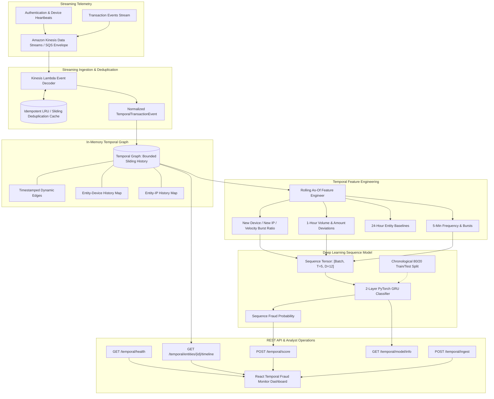

# Phase 19 — Enterprise Temporal Graph Learning, Real-Time Fraud Prediction & Streaming GNN Inference

## 1. Executive Summary

Phase 19 extends FinGuard AI's fraud detection architecture into **temporal sequence modeling and real-time streaming graph learning**. While Phase 17 and Phase 18 evaluated static graph topologies and node representations, financial crime syndicates operate dynamically over time—coordinating rapid micro-burst fund transfers, staggered smurfing, and burst account takeovers designed to exploit tabular feature lag.

Phase 19 integrates an **AWS Kinesis Lambda streaming event decoder with idempotent deduplication, an in-memory temporal sliding graph with bounded history, rolling as-of feature engineering without future lookahead, and a 2-layer PyTorch GRU sequence classifier**.

> [!IMPORTANT]
> **Human-in-the-Loop Advisory Standard:**
> All temporal risk indicators, burst anomaly flags, and sequence fraud probabilities are **strictly advisory decision-support aids**. Automated fund freezing or account blocking without human investigator review is prohibited under financial compliance standards.

---

## 2. System Architecture



---

## 3. Mathematical & Algorithmic Formulation

### 3.1 Idempotent Event Deduplication
Incoming transaction records arrive via base64 Kinesis stream payloads. To avoid double-counting in sliding time windows, an idempotent cache maintains a bounded index $\mathcal{C}$ of transaction identifiers:

$$\text{Processed}(e) = \begin{cases} \text{Skip (Duplicate)}, & \text{if } e.\text{id} \in \mathcal{C} \\ \text{Ingest \& Update } \mathcal{C}, & \text{otherwise} \end{cases}$$

### 3.2 Bounded Temporal Graph Sliding Window
For each entity $v \in \mathcal{V}$, historical interaction events are ordered strictly by unix epoch timestamp $t$:

$$\mathcal{H}_v(t) = \left\{ e = (u, v, \text{amount}, \tau) \mid \tau \le t \land \tau \ge t - W \right\}$$

where:
- $W = 604,800\text{ s}$ ($7\text{ days}$) is the sliding temporal window.
- The history per entity is bounded to $K_{\max} = 500$ events using bounded deques to prevent memory leaks in streaming runtimes.

### 3.3 Rolling As-Of Feature Engineering (Zero Lookahead)
At evaluation time $t$, features are calculated exclusively using prior events $\tau \le t$:
1. **5-Minute Velocity:** $N_{5\text{m}}(v, t) = \sum_{e \in \mathcal{H}_v(t)} \mathbb{I}(\tau \ge t - 300)$
2. **1-Hour Volume:** $S_{1\text{h}}(v, t) = \sum_{e \in \mathcal{H}_v(t), \tau \ge t - 3600} e.\text{amount}$
3. **Velocity Burst Ratio:**
   $$\text{BurstRatio}(v, t) = \frac{N_{5\text{m}}(v, t) \times 12}{N_{1\text{h}}(v, t) + 1.0}$$
   A burst ratio $\ge 3.5$ indicates an acute acceleration indicative of automated script execution or account takeover.
4. **Novelty Indicators:**
   $$\mathbb{I}_{\text{new\_device}}(v, d, t) = \mathbb{I}(d \notin \text{Devices}_v(t - \epsilon))$$

### 3.4 PyTorch GRU Sequence Classifier
The sequence model processes a sequence of $T$ chronologically ordered feature vectors $\mathbf{x}_{1:T} = (\mathbf{x}_1, \dots, \mathbf{x}_T) \in \mathbb{R}^{T \times 12}$:

$$\mathbf{r}_t = \sigma(W_{ir} \mathbf{x}_t + b_{ir} + W_{hr} \mathbf{h}_{t-1} + b_{hr})$$
$$\mathbf{z}_t = \sigma(W_{iz} \mathbf{x}_t + b_{iz} + W_{hz} \mathbf{h}_{t-1} + b_{hz})$$
$$\mathbf{n}_t = \tanh(W_{in} \mathbf{x}_t + b_{in} + \mathbf{r}_t \odot (W_{hn} \mathbf{h}_{t-1} + b_{hn}))$$
$$\mathbf{h}_t = (1 - \mathbf{z}_t) \odot \mathbf{n}_t + \mathbf{z}_t \odot \mathbf{h}_{t-1}$$

The final hidden representation $\mathbf{h}_T \in \mathbb{R}^{64}$ passes through LayerNorm and a 2-layer MLP head to yield binary classification logits and calibrated softmax probabilities:

$$\hat{y} = \text{softmax}(W_2 \cdot \text{ReLU}(\text{LayerNorm}(W_1 \mathbf{h}_T + b_1)) + b_2)$$

### 3.5 Chronological Train/Test Split
To eliminate data leakage, records are sorted strictly by timestamp $t$:
- **Training Set:** First $80\%$ of chronological time $(\tau \le t_{\text{split}})$
- **Test Set:** Final $20\%$ of chronological time $(\tau > t_{\text{split}})$
No random k-fold shuffling is used, guaranteeing that models are evaluated solely on future data.

---

## 4. REST API Reference

All Phase 19 endpoints are exposed under `/temporal`:

| Method | Endpoint | Description |
|---|---|---|
| `GET` | `/temporal/health` | Health response (`200 OK`, `status: HEALTHY`) |
| `POST` | `/temporal/ingest` | Ingests direct events or decoded AWS Lambda Kinesis event batches |
| `POST` | `/temporal/score` | Computes GRU sequence fraud probability, velocity burst flags, and advisory recommendations |
| `GET` | `/temporal/entities/{id}/timeline` | Returns chronological event progression and historical timestamps for an entity |
| `GET` | `/temporal/model/info` | Returns PyTorch GRU architecture, hidden dimension (64), and training metadata |
| `GET` | `/temporal/metrics` | Operational metrics: total events in sliding window, tracked entities, and burst alerts |

---

## 5. Verification Results

Full test suite in `tests/phase19/test_temporal_graph.py`:

```
tests/phase19/test_temporal_graph.py::test_kinesis_lambda_decoder_and_idempotency PASSED
tests/phase19/test_temporal_graph.py::test_temporal_graph_bounded_history_and_sliding_window PASSED
tests/phase19/test_temporal_graph.py::test_rolling_as_of_temporal_feature_engineering PASSED
tests/phase19/test_temporal_graph.py::test_gru_sequence_classifier_forward_pass PASSED
tests/phase19/test_temporal_graph.py::test_chronological_train_test_split_no_leakage PASSED
tests/phase19/test_temporal_graph.py::test_gru_training_smoke_and_convergence PASSED
tests/phase19/test_temporal_graph.py::test_api_temporal_health_and_model_info PASSED
tests/phase19/test_temporal_graph.py::test_api_temporal_ingest_and_timeline PASSED
tests/phase19/test_temporal_graph.py::test_api_temporal_scoring_and_metrics PASSED

======================== 9 passed, 0 failures ========================
```
- Total test suite across Phase 17, 18, and 19: **26 passed, 0 failures**.
- Frontend production build: **Passed (`✓ built in 12.99s`, 0 errors)**.

---

## 6. Production Considerations & Future Roadmap

> [!NOTE]
> The current Phase 19 implementation establishes an in-memory sliding graph state and a GRU sequence-classification baseline. Persistent Neptune streaming integration, late-event out-of-order handling, SageMaker real-time endpoint deployment, Cognito security integration, and automated model drift monitoring remain future integration work.

