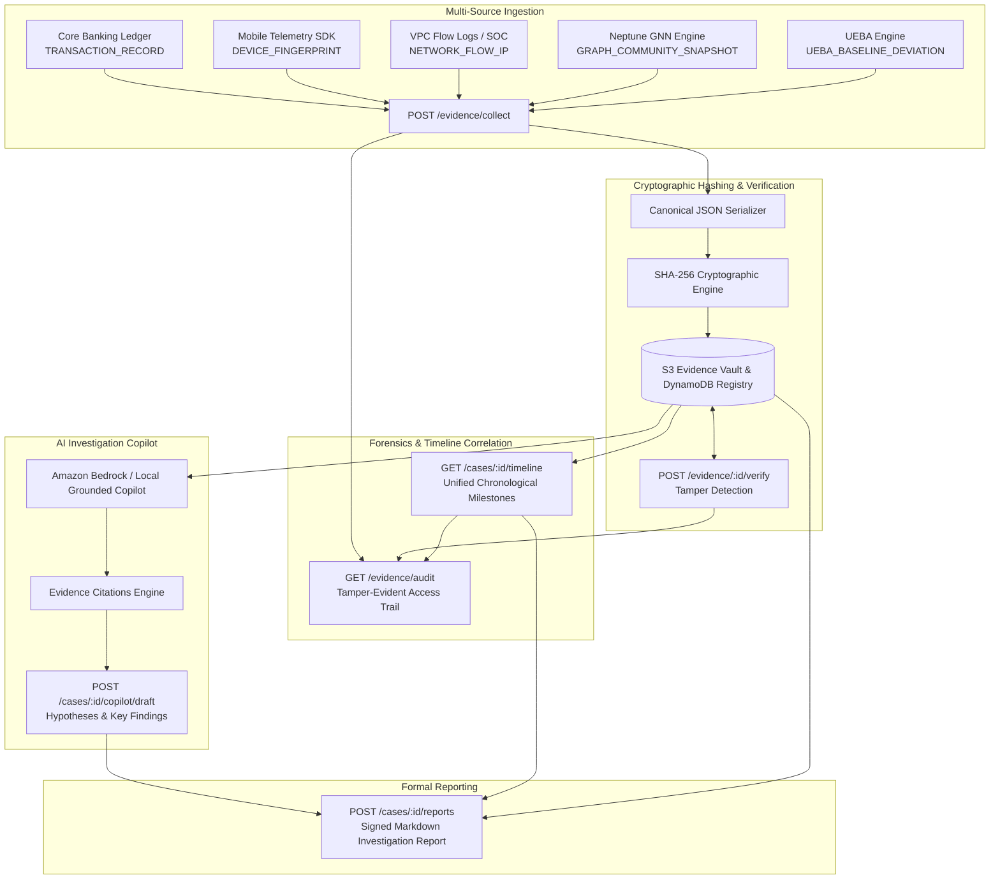

# Phase 22 — Enterprise Fraud Investigation Evidence Management, Digital Forensics & AI Investigation Copilot

## 1. Executive Summary

Phase 22 adds an enterprise-grade digital forensics and evidence-management layer to FinGuard AI. In financial crime investigations, regulatory defense (OCC, FinCEN, CFPB) and legal admissibility require tamper-evident chain-of-custody, cryptographic data integrity guarantees, unified multi-system chronological timelines, and explainable, source-grounded AI intelligence.

Phase 22 delivers:
- **Evidence Collection & Cryptographic Indexing:** Canonical serialization and standard 64-character SHA-256 digest hashing of multi-source evidence payloads.
- **SHA-256 Integrity Verification:** On-demand tamper detection recomputing payload hashes against registered values with immediate tamper alerts.
- **Unified Forensic Case Timeline:** Chronological correlation linking transaction velocity, device fingerprints, network flows, and analyst interventions.
- **Evidence-Grounded AI Investigation Copilot:** Generative investigation synthesis producing threat hypotheses, key findings, and recommended remediation steps with explicit source citations.
- **Analyst Investigation Reports:** Formal compliance reports featuring cryptographic sign-offs, verified evidence tables, and markdown export.
- **Tamper-Evident Access Auditing:** Complete audit trail tracking every collection, view, verification, and report export event.
- **Cloud Infrastructure Foundation:** Production Terraform architecture establishing an S3 Digital Evidence Vault with Object Lock & SSE-KMS, and DynamoDB registries.

---

## 2. Forensic Evidence Architecture

---

## 3. Cryptographic Evidence Integrity Specification

### 3.1 Canonical JSON Serialization
To guarantee identical SHA-256 digests across programming environments, serialization adheres to canonical rules:
1. Keys are strictly sorted in lexicographical order.
2. UTF-8 encoded with no extraneous whitespace (`separators=(",", ":")`).
3. ISO 8601 formatting for datetimes with UTC timezone.

### 3.2 Verification & Tamper Detection
Upon verification invocation:
$$H_{\text{computed}} = \text{SHA-256}(\text{Canonical}(\text{raw\_payload}))$$
$$\text{Status} = \begin{cases} \text{VERIFIED\_AUTHENTIC} & \text{if } H_{\text{computed}} = H_{\text{stored}} \\ \text{TAMPER\_DETECTED} & \text{if } H_{\text{computed}} \neq H_{\text{stored}} \end{cases}$$

---

## 4. REST API Reference

| Endpoint | Method | Description |
| :--- | :--- | :--- |
| `/evidence/health` | `GET` | Forensic vault operational health check |
| `/evidence/collect` | `POST` | Collects, canonicalizes, and hashes an evidence item |
| `/evidence/{evidence_id}` | `GET` | Retrieves evidence payload and logs access audit |
| `/evidence/{evidence_id}/verify` | `POST` | Recomputes SHA-256 and detects tampering |
| `/cases/{case_id}/evidence` | `GET` | Lists all evidence artifacts indexed for a case |
| `/cases/{case_id}/evidence/verify-all` | `POST` | Batch verifies all evidence items for a case |
| `/cases/{case_id}/timeline` | `GET` | Retrieves chronological investigation timeline |
| `/cases/{case_id}/timeline/events` | `POST` | Adds explicit milestone event to timeline |
| `/cases/{case_id}/copilot/draft` | `POST` | Generates AI investigation draft with evidence citations |
| `/cases/{case_id}/reports` | `POST` | Compiles formal investigation report with cryptographic sign-off |
| `/reports/{report_id}` | `GET` | Retrieves signed investigation report |
| `/evidence/audit` | `GET` | Queries tamper-evident evidence access audit log |

---

## 5. Validation Results

| Test Case | Description | Result |
| :--- | :--- | :--- |
| `test_evidence_health_check` | Health check returns HTTP 200 and healthy status | **PASSED** |
| `test_evidence_collection_and_canonical_sha256` | Canonical 64-char SHA-256 generation and indexing | **PASSED** |
| `test_sha256_integrity_verification_authentic` | Verification returns `verified: True` for unmodified evidence | **PASSED** |
| `test_sha256_tamper_detection` | Tamper detection identifies modified payloads with `TAMPER_DETECTED` | **PASSED** |
| `test_case_evidence_timeline_chronological_ordering` | Chronological ordering of multi-source timeline events | **PASSED** |
| `test_ai_investigation_copilot_draft_with_citations` | Synthesizes hypotheses and explicit source citations | **PASSED** |
| `test_analyst_investigation_report_generation` | Generates signed markdown report with evidence tables | **PASSED** |
| `test_evidence_access_audit_logging` | Logs tamper-evident access trail for collection, view, and verification | **PASSED** |

**Summary: 8/8 Tests Passed (100% Success Rate)**

