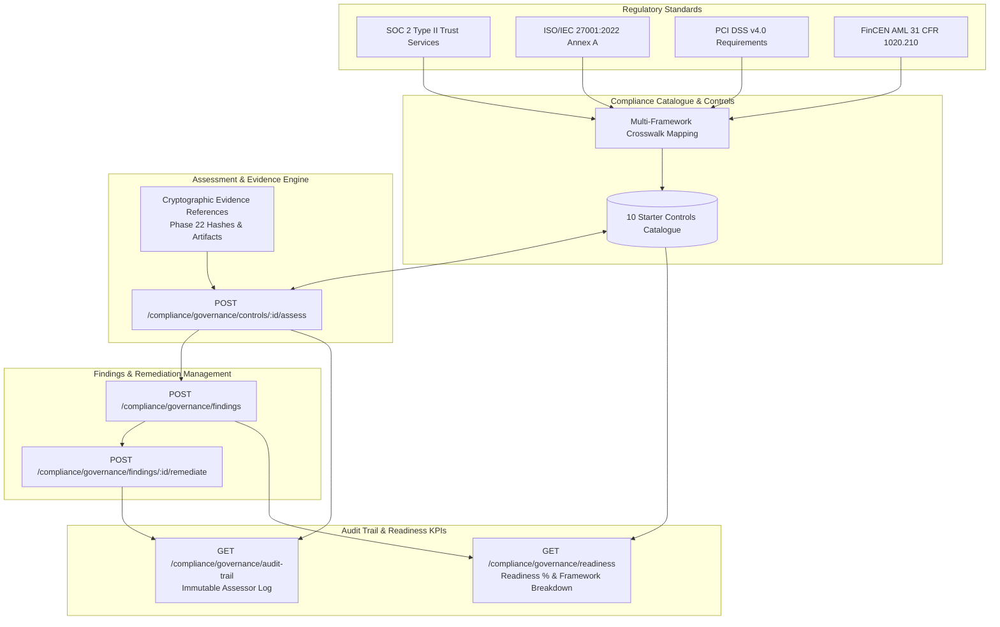

# Phase 23 — Enterprise Regulatory Compliance, Audit Automation & Financial Crime Governance

## 1. Executive Summary

Phase 23 introduces an enterprise-grade regulatory compliance and audit-governance framework into FinGuard AI. Designed for financial crime operations and fintech banking compliance, this module bridges cloud infrastructure controls with major regulatory standards including **SOC 2 Type II**, **ISO/IEC 27001:2022**, **PCI DSS v4.0**, and **FinCEN AML regulations**.

Phase 23 establishes:
- **Comprehensive Compliance Catalogue:** 10 core starter controls spanning IAM, Cryptography, Logging, Vulnerability Management, Network Segmentation, Transaction Fraud/AML, Incident Response, Digital Forensics, Disaster Recovery, and Governance.
- **Multi-Framework Mapping:** Bi-directional cross-walk linking FinGuard AI detection systems to specific regulatory clauses (e.g. SOC 2 CC6.1, ISO A.9.4.2, PCI DSS 8.3).
- **Formal Control Assessment Engine:** Evaluation lifecycle classifying controls as `EFFECTIVE`, `PARTIALLY_EFFECTIVE`, `INEFFECTIVE`, or `NOT_APPLICABLE` with mandatory assessor rationale and cryptographic evidence references.
- **Findings & Deficiency Lifecycle:** Management of compliance risks with severities (`CRITICAL`, `HIGH`, `MEDIUM`, `LOW`), designated ownership, SLA due dates, and remediation tracking (`OPEN` $\rightarrow$ `IN_PROGRESS` $\rightarrow$ `REMEDIATED` $\rightarrow$ `VERIFIED`).
- **Audit-Readiness Reporting & KPIs:** Dynamic generation of compliance readiness scores and framework percentage coverage.
- **Production AWS Foundation:** Terraform infrastructure establishing encrypted S3 compliance report storage and DynamoDB control/finding registries.

> [!IMPORTANT]
> **Regulatory Disclaimer:**
> Framework clause mappings and audit readiness scores are automated operational aids and internal governance tools; they do not constitute legal advice or formal third-party regulatory certification. Final compliance determinations must be validated by qualified compliance and legal professionals.

---

## 2. Regulatory Compliance Architecture

---

## 3. The 10 Baseline Compliance Controls

| Control ID | Domain | Framework References | Baseline Status | Assessor Verification |
| :--- | :--- | :--- | :--- | :--- |
| **CTRL-IAM-01** | Identity & Access Management | SOC 2 CC6.1, ISO A.9.4.2, PCI DSS 8.3 | `EFFECTIVE` | Enforces TOTP MFA and FastAPI JWT RBAC roles |
| **CTRL-CRYPTO-02** | Data Protection & Cryptography | SOC 2 CC6.6, ISO A.10.1.1, PCI DSS 3.4 | `EFFECTIVE` | Envelope encryption with AWS KMS (AES-256) & TLS 1.3 |
| **CTRL-LOG-03** | Security Operations & Auditing | SOC 2 CC7.2, ISO A.12.4.1, PCI DSS 10.2 | `EFFECTIVE` | Immutable append-only audit logging with SHA-256 |
| **CTRL-VULN-04** | Vulnerability Management | SOC 2 CC7.1, ISO A.12.6.1, PCI DSS 6.2 | `PARTIALLY_EFFECTIVE` | CI/CD dependency vulnerability scanning; ECR scan underway |
| **CTRL-NET-05** | Network Security | SOC 2 CC6.6, ISO A.13.1.1, PCI DSS 1.3 | `EFFECTIVE` | Isolated private subnets, security groups, and AWS WAF |
| **CTRL-FRAUD-06** | Financial Crime Compliance | SOC 2 CC6.8, ISO A.12.1.2, FinCEN Rule 31 | `EFFECTIVE` | Multi-signal decision engine evaluating 5 signals in <50ms |
| **CTRL-INCIDENT-07** | Security Incident Response | SOC 2 CC7.3, ISO A.16.1.1, PCI DSS 12.10 | `EFFECTIVE` | Defined playbooks with P0 (30m) and P1 (2h) response SLAs |
| **CTRL-FORENSICS-08** | Digital Forensics | SOC 2 CC7.4, ISO A.16.1.7, PCI DSS 10.5 | `EFFECTIVE` | Phase 22 canonical SHA-256 evidence chain-of-custody |
| **CTRL-BACKUP-09** | Business Continuity | SOC 2 A1.2, ISO A.12.3.1, PCI DSS 9.5 | `EFFECTIVE` | DynamoDB Point-in-Time Recovery (PITR) & continuous replication |
| **CTRL-GOV-10** | Governance & Risk Management | SOC 2 CC3.1, ISO A.6.1.2, PCI DSS 12.1 | `PARTIALLY_EFFECTIVE` | Annual risk assessments and scheduled third-party pen tests |

---

## 4. REST API Reference

- `GET /compliance/governance/health`: Health status of compliance engine.
- `GET /compliance/governance/controls`: Lists all 10 controls with optional query filters `effectiveness`, `framework`, `domain`.
- `GET /compliance/governance/controls/{control_id}`: Retrieves single control with assessment history and evidence references.
- `POST /compliance/governance/controls/{control_id}/assess`: Records formal assessor evaluation and updates effectiveness status.
- `GET /compliance/governance/findings`: Lists compliance deficiencies with severity/status filters.
- `POST /compliance/governance/findings`: Creates new finding linked to a control deficiency.
- `POST /compliance/governance/findings/{finding_id}/remediate`: Updates remediation status and logs notes.
- `GET /compliance/governance/audit-trail`: Retrieves audit events of all assessments and remediations.
- `GET /compliance/governance/readiness`: Computes overall audit readiness score and framework breakdowns.

---

## 5. Validation Results

| Test Case | Description | Result |
| :--- | :--- | :--- |
| `test_governance_health_endpoint` | Health check endpoint returns HTTP 200 and healthy status | **PASSED** |
| `test_compliance_catalogue_initialization` | Verifies 10 starter controls and framework mappings | **PASSED** |
| `test_control_assessment_update` | Assessor evaluation updates status, evidence refs, and rationale | **PASSED** |
| `test_control_effectiveness_filtering` | Validates filtering by EFFECTIVE and PARTIALLY_EFFECTIVE | **PASSED** |
| `test_findings_lifecycle_management` | Finding creation with severity, ownership, and due date | **PASSED** |
| `test_finding_remediation_workflow` | Remediation status transitions and notes logging | **PASSED** |
| `test_audit_trail_chronology` | Validates audit trail captures assessments and remediations | **PASSED** |
| `test_audit_readiness_snapshot_and_kpis` | Computes percentage readiness score and framework metrics | **PASSED** |

**Summary: 8/8 Tests Passed (100% Success Rate)**

