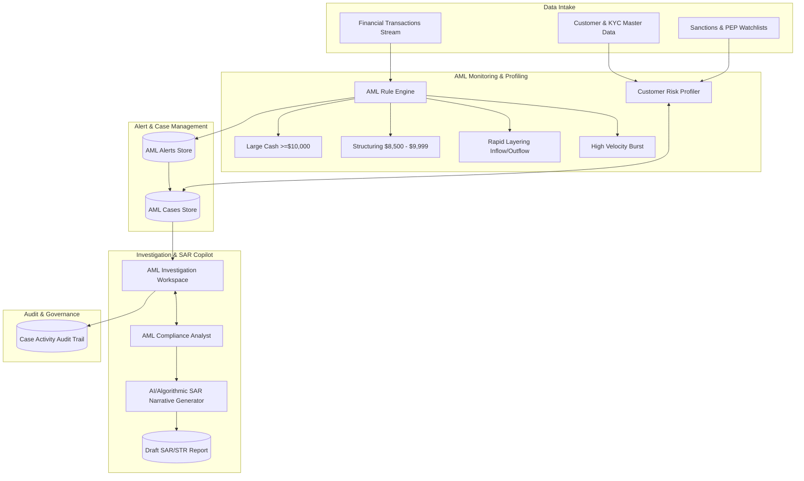

# Phase 24 — Enterprise AML Transaction Monitoring, Customer Risk Profiling & Suspicious Activity Investigation

## 1. Executive Summary

Phase 24 expands FinGuard AI from fraud detection into an enterprise-grade **Anti-Money Laundering (AML)** transaction monitoring, customer risk profiling, and suspicious activity investigation platform. 

In financial institutions, AML compliance operates under strict regulatory mandates (including the Bank Secrecy Act, USA PATRIOT Act, FinCEN regulations, and FATF Recommendations). Phase 24 provides the computational backbone for detecting laundering typologies, profiling customer risk, managing alert queues, and drafting evidence-backed **Suspicious Activity Reports (SAR/STR)**.

Phase 24 establishes:
- **Rule-Based Typology Detection:** Transparent, explainable rule engine detecting:
  1. *Large Cash Transactions* ($\ge \$10,000$ BSA threshold).
  2. *Structuring / Smurfing* (Multiple transactions in the $\$8,500 - \$9,999$ corridor designed to evade reporting thresholds).
  3. *Rapid Inflow/Outflow Layering* (High proportion of deposited funds disbursed within 24 hours).
  4. *High Velocity Burst* (Abnormal count of transactions within a short time window).
- **Customer Risk Profiling:** Dynamic risk tier calculation (`LOW`, `MEDIUM`, `HIGH`, `CRITICAL`) incorporating Politically Exposed Person (PEP) sanctions flags, transaction velocity, country risk factors, and prior alert history.
- **SAR / STR Investigation Drafting Engine:** Structured Suspicious Activity Report generation synthesizing subject identity, narrative summaries, suspect transaction lists, and financial impact figures.
- **Case Investigation Lifecycle & Audit:** Dedicated case lifecycle management (`OPEN` $\rightarrow$ `UNDER_REVIEW` $\rightarrow$ `SAR_FILED` / `CLOSED_FALSE_POSITIVE`), analyst notes, and immutable activity auditing.
- **Analyst Investigation Console:** High-density React/TypeScript workspace featuring live rule triggers, SAR narrative drafts, risk profiling breakdowns, and manual case workflow transitions.
- **AWS Terraform Infrastructure:** Production-ready S3 evidence/report storage and DynamoDB table foundation for AML alerts, profiles, cases, and SAR filings.

> [!IMPORTANT]
> **Advisory & Regulatory Governance Disclaimer:**
> FinGuard AI AML detections and SAR drafts are strictly **advisory decision-support tools** for certified Compliance Officers and AML Analysts. The system does not automatically freeze customer accounts, decline transactions, or transmit filings to regulatory authorities (such as FinCEN or FIUs) without explicit human review and authorization.

---

## 2. AML System Architecture

---

## 3. AML Typology Rules & Algorithms

| Rule Code | Typology Name | Threshold / Condition | Regulatory Basis |
| :--- | :--- | :--- | :--- |
| `LARGE_CASH` | Currency Transaction Report Trigger | Transaction Amount $\ge \$10,000.00$ | 31 CFR § 1010.311 (BSA CTR Rule) |
| `STRUCTURING` | Smurfing / Avoidance of Thresholds | $\ge 2$ transactions within 48h, each between $\$8,500$ and $\$9,999$ | 31 U.S.C. § 5324 |
| `RAPID_INFLOW_OUTFLOW` | Layering & Swift Capital Flight | Total Outflow $\ge 80\%$ of Inflow within 24h window | FATF Recommendation 20 |
| `HIGH_VELOCITY` | Smurfing / Automated Scripting | $\ge 4$ transactions within a rolling 60-minute window | FinCEN Guidance FIN-2019-G001 |

### Customer Risk Scoring Formula

Customer risk scores range between $0$ and $100$:

$$\text{Risk Score} = \text{Clamp}_{0}^{100} \left( \text{Base} + \Delta_{\text{PEP}} + \Delta_{\text{Alerts}} + \Delta_{\text{Volume}} + \Delta_{\text{Jurisdiction}} \right)$$

Where:
- $\text{Base} = 15$
- $\Delta_{\text{PEP}} = +35$ if the customer is identified on a PEP list.
- $\Delta_{\text{Alerts}} = +15 \times (\text{lifetime active AML alerts})$.
- $\Delta_{\text{Volume}} = +10$ if lifetime transaction volume exceeds $\$100,000$.
- $\Delta_{\text{Jurisdiction}} = +20$ if customer resides in a FATF high-risk or non-cooperative jurisdiction.

**Risk Tiers:**
- **`LOW`**: $0 - 30$
- **`MEDIUM`**: $31 - 60$
- **`HIGH`**: $61 - 85$
- **`CRITICAL`**: $86 - 100$

---

## 4. API Specification

| Endpoint | Method | Purpose |
| :--- | :--- | :--- |
| `/api/v1/aml/transactions/evaluate` | `POST` | Ingests transaction payload and evaluates against all 4 AML typology rules |
| `/api/v1/aml/customers/{id}/profile` | `GET` | Fetches or computes dynamic customer risk profile and risk factors |
| `/api/v1/aml/alerts` | `GET` | Lists recent AML alerts across the institution with severity filters |
| `/api/v1/aml/cases` | `GET` / `POST` | Lists existing AML cases or initiates a new AML investigation |
| `/api/v1/aml/cases/{id}` | `GET` | Retrieves full case file including linked alerts, transactions, and notes |
| `/api/v1/aml/cases/{id}/status` | `PUT` | Updates case status with mandatory reason, updating the immutable audit log |
| `/api/v1/aml/cases/{id}/sar` | `POST` | Generates a structured SAR/STR narrative draft ready for analyst review |
| `/api/v1/aml/cases/{id}/notes` | `POST` | Appends timestamped investigator note to the case history |

---

## 5. Security & Infrastructure Architecture

The Phase 24 infrastructure is provisioned through Terraform in `infrastructure/terraform/phase24/`:
1. **Encrypted S3 Bucket:** Stores SAR narrative drafts, transaction snapshots, and regulatory report exports with AES-256 server-side encryption and enforced TLS 1.3 transit encryption.
2. **DynamoDB Tables:**
   - `finguard-aml-alerts`: Primary key `alert_id`, with GSI on `customer_id`.
   - `finguard-aml-profiles`: Primary key `customer_id`.
   - `finguard-aml-cases`: Primary key `case_id`, with GSI on `status`.
   - `finguard-aml-sar-reports`: Primary key `sar_id`.
3. **IAM Least-Privilege Policies:** Grants AML services strictly necessary read/write actions on customer risk and transaction records.

