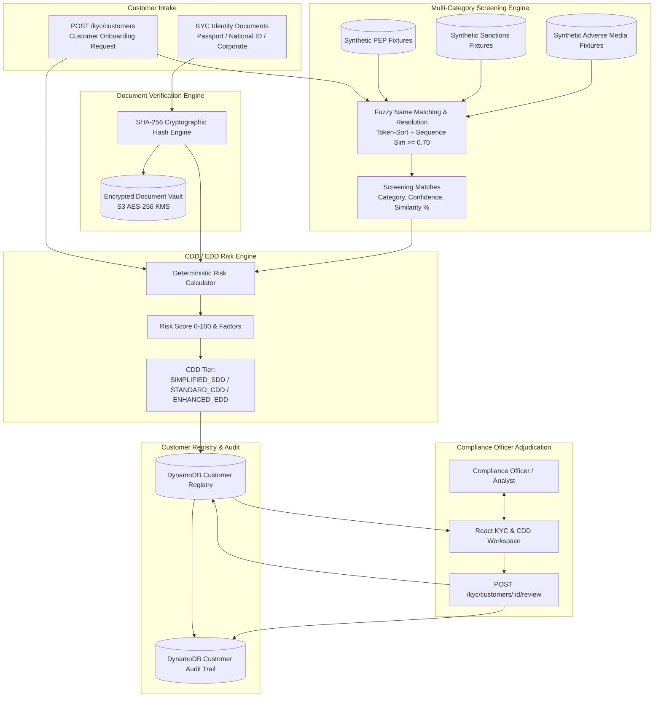

# Phase 25 — Enterprise Customer Onboarding, KYC, Customer Due Diligence (CDD), Enhanced Due Diligence (EDD), PEP / Sanctions / Adverse Media Screening & Compliance Review

## 1. Executive Summary

Phase 25 establishes a comprehensive, enterprise-grade **Customer Onboarding, KYC (Know Your Customer), Customer Due Diligence (CDD), Enhanced Due Diligence (EDD), and Multi-Category Screening Platform** for FinGuard AI.

Before any transaction is executed or evaluated by real-time ML fraud detectors (Phases 1–21) or AML transaction monitors (Phase 24), the financial institution must verify customer identity, assess geographic and entity risk factors, and screen individuals and legal entities against sanctions watchlists, Politically Exposed Person (PEP) registers, and adverse media reports.

Phase 25 provides:
- **Idempotent Customer Registration:** Safe onboarding of individual and corporate profiles with deduplication and state tracking.
- **Cryptographic Document Verification:** KYC identity documents (Passport, National ID, Driving License, Tax ID, Corporate Certificate) registered with SHA-256 integrity verification.
- **Multi-Category Synthetic Screening:** Automated screening against synthetic PEP, Sanctions, and Adverse Media fixtures.
- **Fuzzy Entity Resolution & Name Matching:** Resilient token-sort and sequence similarity algorithm handling spelling variations, reordered names, and partial tokens.
- **Explainable Customer Risk & Tiering:** Deterministic 0–100 risk scoring assigning customers to `SIMPLIFIED_SDD`, `STANDARD_CDD`, or `ENHANCED_EDD` tiers across `LOW`, `MEDIUM`, `HIGH`, and `CRITICAL` risk categories.
- **Human-in-the-Loop Compliance Review:** Formal compliance adjudication console (`APPROVED`, `REJECTED`, `ESCALATED_EDD`, `REQUEST_INFO`) with mandatory analyst rationale.
- **Immutable Customer Audit Trail:** Cryptographically referenced event logs tracking registration, uploads, screenings, and compliance decisions.
- **AWS Terraform Infrastructure:** S3 encrypted document vault with KMS AES-256 encryption and DynamoDB tables for customers, matches, and audit logs.

> [!IMPORTANT]
> **Advisory & Regulatory Governance Disclaimer:**
> - Screening fixtures provided in FinGuard AI are synthetic fixtures for development, testing, and system demonstrations—not live official UN, OFAC, EU, or government sanctions lists.
> - Fuzzy similarity scoring surfaces candidate matches for human compliance officer investigation; it does not constitute confirmed legal identity.
> - Customer risk scoring is illustrative decision support; final onboarding and account status decisions require human compliance verification.

---

## 2. Onboarding & Screening Architecture

---

## 3. Screening & Fuzzy Matching Engine

### Name Normalization & Similarity Formula

Customer names are normalized by lowercasing, stripping punctuation, and sorting tokens. Given strings $S_1$ and $S_2$:

$$\text{Similarity}(S_1, S_2) = \max \left( \text{Ratio}_{\text{seq}}(S_1, S_2), \; \text{Ratio}_{\text{seq}}(\text{TokensSorted}(S_1), \text{TokensSorted}(S_2)), \; \text{JaccardOverlap}(S_1, S_2) \right)$$

### Match Confidence Mapping

| Similarity Score | Match Confidence | Action / Recommendation |
| :--- | :--- | :--- |
| $\ge 0.95$ | `EXACT` | Automatic alert; triggers mandatory EDD review |
| $0.85 - 0.94$ | `HIGH` | High-confidence match; secondary identifier inspection |
| $0.70 - 0.84$ | `MEDIUM` | Potential phonetic/alias match; analyst discretion |
| $< 0.70$ | `LOW` | Below screening alert threshold |

---

## 4. Explainable CDD / EDD Risk Formulation

Customer risk scores range between $0.0$ and $100.0$:

$$\text{Risk Score} = \min \left( 100.0, \; \text{Base} + \Delta_{\text{Corp}} + \Delta_{\text{Country}} + \Delta_{\text{Docs}} + \Delta_{\text{Screening}} \right)$$

Where:
- $\text{Base} = 10.0$
- $\Delta_{\text{Corp}} = +10.0$ for corporate entities (beneficial ownership verification).
- $\Delta_{\text{Country}} = +35.0$ for high-risk jurisdictions (`KP`, `IR`, `MM`, `SY`, `CU`, `YE`), or $+15.0$ for monitored offshore jurisdictions (`KY`, `PA`, `VG`, `CY`, `AE`).
- $\Delta_{\text{Docs}} = +20.0$ if no verified documents are attached, or $+15.0$ if government-issued photo ID is missing.
- $\Delta_{\text{Screening}} = +50.0$ for Sanctions hit, $+35.0$ for PEP hit, $+20.0$ for Adverse Media.

### CDD Tiers and Onboarding Status Mapping

| Risk Level | Score Range | CDD Tier | Default Initial Onboarding Status |
| :--- | :--- | :--- | :--- |
| **`LOW`** | $0.0 - 29.9$ | `SIMPLIFIED_SDD` | `PENDING_REVIEW` (Auto-approvable) |
| **`MEDIUM`** | $30.0 - 54.9$ | `STANDARD_CDD` | `PENDING_REVIEW` |
| **`HIGH`** | $55.0 - 79.9$ | `ENHANCED_EDD` | `EDD_REQUIRED` |
| **`CRITICAL`** | $80.0 - 100.0$ | `ENHANCED_EDD` | `EDD_REQUIRED` (Sanctions escalation) |

---

## 5. API Specification

| Endpoint | Method | Purpose |
| :--- | :--- | :--- |
| `/api/v1/kyc/health` | `GET` | Health check endpoint returning service status and version |
| `/api/v1/kyc/customers` | `POST` | Onboards new customer with idempotent creation and automatic screening |
| `/api/v1/kyc/customers` | `GET` | Lists customers with optional filters for `status` and `risk_level` |
| `/api/v1/kyc/customers/{id}` | `GET` | Retrieves full customer file, risk assessment, and document records |
| `/api/v1/kyc/customers/{id}/documents` | `POST` | Uploads/registers verification document with SHA-256 hash |
| `/api/v1/kyc/customers/{id}/screen` | `POST` | Runs on-demand multi-category screening (PEP, Sanctions, Adverse Media) |
| `/api/v1/kyc/customers/{id}/review` | `POST` | Records compliance officer review decision with mandatory rationale |
| `/api/v1/kyc/customers/{id}/audit-trail` | `GET` | Retrieves chronological audit event log for customer |

---

## 6. Infrastructure & Deployment Foundation

The Phase 25 cloud infrastructure is defined in `infrastructure/terraform/phase25/`:
- **`aws_s3_bucket.kyc_vault`**: S3 bucket with versioning and KMS server-side encryption for verification documents.
- **`aws_dynamodb_table.kyc_customers`**: DynamoDB customer master table with GSI on `onboarding_status`.
- **`aws_dynamodb_table.screening_matches`**: DynamoDB table storing screening hits with GSI on `category`.
- **`aws_dynamodb_table.kyc_audit_trail`**: Partition key `customer_id`, sort key `event_id` tracking all compliance actions.

