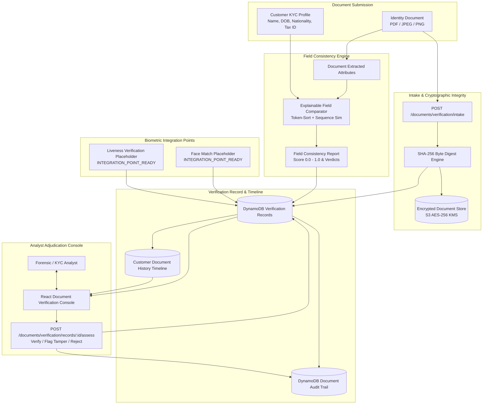

# Phase 26 — Enterprise Customer Identity Verification, Document Intelligence, Biometric Verification & Fraudulent Document Detection Foundation

## 1. Executive Summary

Phase 26 establishes the **Customer Identity Verification, Document Intelligence, Cryptographic Byte Integrity, and Field Consistency Architecture** for FinGuard AI.

In digital customer onboarding and ongoing fraud prevention, financial crime operations require automated yet explainable verification of identity documents (such as Passports, National IDs, Driving Licenses, and PAN/Aadhaar synthetic records) before granting financial privileges or clearing AML/KYC requirements.

Phase 26 delivers:
- **Multi-Format Document Intake:** Ingestion and validation of identity documents across `PDF`, `JPEG`, and `PNG` with MIME type enforcement and payload size tracking.
- **Cryptographic Byte Integrity & Tamper Detection:** Canonical SHA-256 digest computation upon ingestion, enabling zero-trust byte integrity comparison to detect post-ingestion alteration or document tampering.
- **Explainable Field Consistency Engine:** Automated congruence checks comparing extracted document attributes (full name, date of birth, issuing country, document identifier) against expected customer KYC profiles using resilient token-sort and sequence similarity algorithms.
- **Customer Identity Document Timeline:** Chronological customer identity history recording all submitted documents, statuses, and verification milestones.
- **Comprehensive Audit Logging:** Append-only audit events tracking ingestion, integrity comparisons, tamper alerts, and analyst adjudications.
- **Biometric Integration Foundation:** Standardized integration placeholders for downstream facial matching and liveness verification services.
- **Analyst Forensic Workspace:** React/TypeScript console featuring live field consistency matrices, tamper simulation triggers, document timelines, and compliance assessment workflows.
- **AWS Terraform Infrastructure:** S3 encrypted document asset repository and DynamoDB tables for verification records and audit events.

> [!IMPORTANT]
> **Implementation Boundaries & Privacy Disclaimer:**
> - Phase 26 establishes a production-grade document intake, byte integrity, and verification workflow foundation. Advanced OCR, deep-learning forgery detection, facial comparison, and liveness verification are designated integration points for third-party or AWS services (e.g. Amazon Rekognition, Textract).
> - SHA-256 verification validates **byte-level cryptographic integrity** (confirming data has not changed since ingestion), not legal physical document authenticity.
> - All identity records, names, PANs, and Aadhaar numbers used in development and testing are **strictly synthetic fixtures**. Never upload real government-issued identification numbers or live biometric data to development environments.

---

## 2. Document Verification Architecture

---

## 3. Cryptographic Byte Integrity & Tamper Detection

When an identity document is ingested, its raw byte stream is hashed using SHA-256:

$$\text{Digest} = \text{SHA-256}(\text{RawBytes})$$

This digest is stored immutably in the verification record. During periodic integrity scans or upon re-verification, the hash of the current document asset is recomputed and compared:

$$\text{IsAuthentic} = \left( \text{SHA-256}(\text{CurrentBytes}) == \text{RecordedDigest} \right)$$

If $\text{IsAuthentic} == \text{False}$, the system:
1. Immediately transitions status to `TAMPER_DETECTED`.
2. Emits a high-priority security audit event `TAMPER_DETECTED`.
3. Flags the document in the analyst dashboard for forensic review.

---

## 4. Explainable Field Consistency Matrix

Extracted document fields are compared against customer profile records across key identity attributes:

| Field | Verification Method | Matching Criteria | Sample Explanation |
| :--- | :--- | :--- | :--- |
| `full_name` | Hybrid token-sort + sequence similarity | $\ge 0.95$: MATCH $0.70-0.94$: PARTIAL_MATCH $< 0.70$: MISMATCH | Handles reordered tokens (*"Connor, Sarah"* vs *"Sarah Connor"*) or middle initials |
| `date_of_birth` | ISO normalized date comparison | Exact string match | Detects mismatched birth dates across documents |
| `issuing_country` | ISO country code normalization | Exact 2 or 3-letter match | Verifies document matches customer country |
| `id_number` | Masked alphanumeric string comparison | Exact or suffix match | Confirms identity number matches account registration |

**Overall Consistency Score:**
$$\text{Score}_{\text{overall}} = \frac{1}{N} \sum_{i=1}^{N} \text{Similarity}(F_{\text{doc}, i}, F_{\text{exp}, i})$$

A document is deemed consistent (`is_consistent = True`) if $\text{Mismatch Count} == 0$ and $\text{Score}_{\text{overall}} \ge 0.75$.

---

## 5. API Specification

| Endpoint | Method | Purpose |
| :--- | :--- | :--- |
| `/api/v1/documents/verification/health` | `GET` | Health check endpoint returning status and service version |
| `/api/v1/documents/verification/intake` | `POST` | Ingests document (PDF/JPEG/PNG), computes SHA-256, and runs field consistency checks |
| `/api/v1/documents/verification/records` | `GET` | Lists verification records across the institution or filtered by `customer_id` |
| `/api/v1/documents/verification/records/{id}` | `GET` | Retrieves full document verification record and consistency report |
| `/api/v1/documents/verification/records/{id}/tamper-check` | `POST` | Re-evaluates content against recorded SHA-256 digest to detect tampering |
| `/api/v1/documents/verification/records/{id}/assess` | `POST` | Records analyst decision (`VERIFY`, `FLAG_TAMPER`, `REJECT_INCONSISTENT`) with rationale |
| `/api/v1/documents/verification/customers/{id}/timeline` | `GET` | Retrieves customer identity document history timeline |
| `/api/v1/documents/verification/customers/{id}/audit-trail` | `GET` | Retrieves chronological audit event log for customer document events |

---

## 6. AWS Infrastructure & Security

Defined in `infrastructure/terraform/phase26/`:
- **`aws_s3_bucket.identity_doc_store`**: Dedicated document asset storage with S3 versioning and KMS server-side encryption.
- **`aws_dynamodb_table.doc_verification_records`**: Partition key `verification_id`, with Global Secondary Index on `customer_id`.
- **`aws_dynamodb_table.doc_audit_trail`**: Partition key `customer_id`, sort key `event_id` tracking all verification lifecycle operations.

