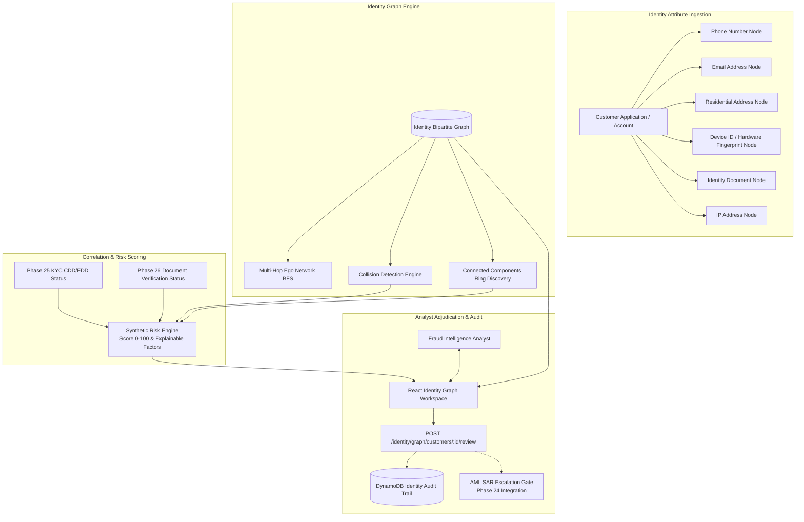

# Phase 27 — Synthetic Identity Fraud Detection & Identity Graph Intelligence

## 1. Executive Summary

Phase 27 establishes the **Synthetic Identity Fraud Detection, Attribute Collision Analysis, and Identity Graph Intelligence Platform** for FinGuard AI.

Synthetic identity fraud is one of the fastest-growing and most evasive forms of financial crime. Fraudsters synthesize fictitious profiles by combining legitimate identifiers (e.g. real Social Security Numbers or Tax IDs) with fabricated names, shared virtual phone numbers, temporary email domains, hardware emulators, and shared physical addresses to open accounts, build credit profiles, and execute bust-out fraud.

Phase 27 delivers:
- **Multi-Attribute Collision Detection:** Real-time identification of shared phones, emails, physical addresses, hardware device IDs, IP subnets, and identity documents across multiple distinct customer accounts.
- **Identity Graph Network Engine:** Bipartite graph modeling customers and their underlying identity attributes, supporting multi-hop neighborhood traversal, degree centrality, and collision clustering.
- **Identity Ring Cluster Discovery:** Graph-based connected components algorithms that unmask organized synthetic fraud rings and mule syndicates sharing common infrastructure.
- **Explainable Heuristic Risk Scoring:** Deterministic $0 - 100$ risk formulation combining collision counts, attribute penalties, Phase 25 KYC status (CDD/EDD), Phase 26 document verification integrity flags, and network cluster sizes.
- **Analyst Investigation Console:** Interactive React/TypeScript dashboard with visual graph node canvas, collision directory, risk profiling breakdown, and formal adjudication workflows (`FLAG_SYNTHETIC_RING`, `CLEAR_COLLISION`, `REQUEST_EDD`).
- **AWS Terraform Infrastructure:** S3 identity graph snapshot vault and DynamoDB tables for graph nodes, collisions, and audit logs.
- **Synthetic Identity Generator CLI:** Automated script (`scripts/generate_identities.py`) for generating large-scale synthetic applicant datasets with configurable collision rates.

> [!IMPORTANT]
> **Advisory & Operational Governance Disclaimer:**
> - The identity graph, collision scores, and ring discovery algorithms are **investigative decision-support aids** for fraud analysts.
> - Shared attributes (e.g. shared physical address or IP) may represent legitimate circumstances (such as corporate offices, co-living arrangements, or family households). No customer account is automatically blocked or frozen without certified human review.
> - Default data stores operate in memory for local development with synthetic data; AWS KMS, S3, and DynamoDB Terraform templates are provided for production deployments.

---

## 2. Identity Graph Architecture

---

## 3. Attribute Collision Classification & Severity

| Collision Type | Target Entity | Shared Threshold | Default Penalty | Severity Tier |
| :--- | :--- | :--- | :--- | :--- |
| `DOCUMENT_COLLISION` | Document Number / Hash | $\ge 2$ Customers | $+40.0$ | `CRITICAL` |
| `DEVICE_COLLISION` | Device Hardware Fingerprint | $\ge 2$ Customers | $+25.0$ | `HIGH` |
| `PHONE_COLLISION` | Phone Number | $\ge 2$ Customers | $+25.0$ | `HIGH` |
| `EMAIL_COLLISION` | Email Address | $\ge 2$ Customers | $+20.0$ | `MEDIUM` |
| `ADDRESS_COLLISION` | Physical Street Address | $\ge 3$ Customers | $+15.0$ | `MEDIUM` |

---

## 4. Synthetic Identity Risk Scoring Formulation

$$\text{Risk Score} = \min \left( 100.0, \; \text{Base} + \sum \Delta_{\text{Collisions}} + \Delta_{\text{KYC}} + \Delta_{\text{Forensic}} + \Delta_{\text{Cluster}} \right)$$

Where:
- $\text{Base} = 5.0$
- $\Delta_{\text{Collisions}}$: Cumulative penalties from detected attribute collisions.
- $\Delta_{\text{KYC}} = +15.0$ if KYC compliance status is `EDD_REQUIRED` or `REJECTED`.
- $\Delta_{\text{Forensic}} = +25.0$ if Phase 26 document verification flagged `INCONSISTENT_FIELDS` or `TAMPER_DETECTED`.
- $\Delta_{\text{Cluster}} = +15.0$ if the customer is connected to an identity ring of size $\ge 3$.

### Risk Tiers
- **`LOW`**: $0.0 - 29.9$ (Clean applicant footprint)
- **`MEDIUM`**: $30.0 - 59.9$ (Single benign collision or address sharing)
- **`HIGH`**: $60.0 - 79.9$ (Multiple colliding attributes, hardware emulation)
- **`CRITICAL`**: $80.0 - 100.0$ (High-density synthetic fraud ring, document reuse)

---

## 5. API Specification

| Endpoint | Method | Purpose |
| :--- | :--- | :--- |
| `/api/v1/identity/graph/health` | `GET` | Health check endpoint returning service version and status |
| `/api/v1/identity/graph/register` | `POST` | Registers customer identity attributes into graph and evaluates real-time risk |
| `/api/v1/identity/graph/subgraph` | `GET` | Retrieves ego network nodes and edges for visual graph canvas |
| `/api/v1/identity/graph/collisions` | `GET` | Lists all detected cross-customer attribute collisions |
| `/api/v1/identity/graph/clusters` | `GET` | Identifies connected synthetic ring clusters and member accounts |
| `/api/v1/identity/graph/customers/{id}/risk` | `GET` | Fetches explainable synthetic identity risk profile with KYC correlation |
| `/api/v1/identity/graph/customers/{id}/review` | `POST` | Submits formal analyst decision (`FLAG_SYNTHETIC_RING`, `CLEAR_COLLISION`) |
| `/api/v1/identity/graph/customers/{id}/audit-trail` | `GET` | Retrieves chronological audit event log |

---

## 6. AWS Infrastructure & Security

Defined in `infrastructure/terraform/phase27/`:
- **`aws_s3_bucket.identity_graph_vault`**: Encrypted S3 bucket for identity graph snapshots and network topology backups.
- **`aws_dynamodb_table.identity_nodes`**: Graph node registry with Global Secondary Index on `node_type`.
- **`aws_dynamodb_table.identity_collisions`**: Stores detected collisions with Global Secondary Index on `severity`.
- **`aws_dynamodb_table.identity_audit_trail`**: Partition key `customer_id`, sort key `event_id` tracking all identity review operations.

