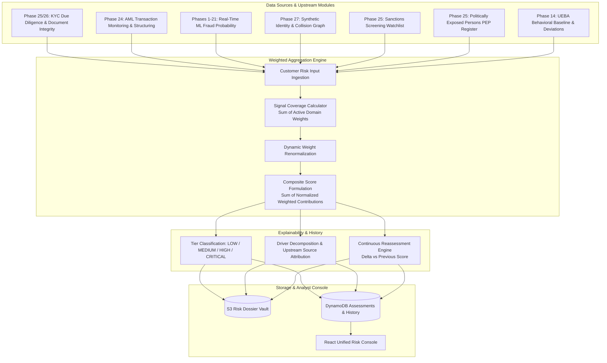

# Phase 28 — Enterprise Advanced Customer Risk Intelligence, Unified KYC, AML & Fraud Risk Profiling

## 1. Executive Summary

Phase 28 establishes the **Unified Customer Risk Intelligence Engine** for FinGuard AI, synthesizing previously siloed risk signals across **KYC, AML, Fraud Detection, Identity Graph Intelligence, Sanctions, PEP, and Behavioral Analytics** into a dynamic, continuously reassessable composite risk score.

In enterprise banking and fintech operations, risk assessments are frequently fragmented across disparate compliance and fraud silos. Phase 28 breaks down these data islands by providing:
- **Unified 7-Domain Aggregation:** Harmonizes 7 key financial crime risk domains using an empirically weighted framework.
- **Dynamic Signal Coverage & Renormalization:** Intelligently adapts to incomplete or staged data by excluding unassessed domains, renormalizing active weights, and calculating explicit signal coverage percentages.
- **Explainable Driver Attribution:** Transparently details the exact point contribution of each domain, listing underlying behavioral indicators and upstream source references.
- **Continuous Risk Reassessment:** Maintains an immutable historical timeline per customer, tracking score deltas, risk level transitions, and trajectory direction (`INCREASED`, `DECREASED`, `STABLE`).
- **Analyst Prioritization Console:** High-density React/TypeScript workspace with multi-domain decomposition cards, historical trendline, and live reassessment execution.
- **Production AWS Foundation:** S3 encrypted risk dossier vault and DynamoDB tables for assessments and continuous customer history.

> [!IMPORTANT]
> **Advisory & Prioritization Standard Disclaimer:**
> Unified customer risk scores are rules-based operational prioritization tools designed to assist certified Compliance Officers and Fraud Investigators in allocating investigation bandwidth. They do **not** constitute automated credit decisions, legal guilt, or automated account freezing/blocking without human compliance verification.

---

## 2. Unified Risk Architecture

---

## 3. The 7 Risk Domains & Default Weights

The unified risk engine combines seven risk domains using calibrated default weights summing to $1.00$ ($100\%$):

| Risk Domain | Default Weight | Target Scope & Upstream Source |
| :--- | :--- | :--- |
| **AML** | **22%** ($0.22$) | Phase 24 transaction monitoring, structuring, and pass-through layering |
| **Fraud** | **20%** ($0.20$) | Phases 1–21 ML fraud classification, velocity bursts, and decision policies |
| **KYC** | **18%** ($0.18$) | Phase 25 CDD/EDD verification and Phase 26 document byte integrity |
| **Identity** | **16%** ($0.16$) | Phase 27 attribute collisions (phone, device, address) and synthetic rings |
| **Sanctions** | **14%** ($0.14$) | Phase 25 synthetic sanctions watchlist screening hits |
| **PEP** | **5%** ($0.05$) | Phase 25 Politically Exposed Persons register matches |
| **Behavioral**| **5%** ($0.05$) | Phase 14 UEBA login deviations and transaction velocity anomalies |
| **Total** | **100%** ($1.00$) | Full 7-domain coverage |

---

## 4. Signal Coverage & Weight Renormalization Algorithm

When an applicant has only a subset of risk domains evaluated, the engine excludes missing domains and renormalizes the weights of provided domains to guarantee a valid $0 - 100$ scale:

1. **Calculate Active Weight Sum ($W_{\text{active}}$):**
   $$W_{\text{active}} = \sum_{d \in \text{Provided}} w_d$$

2. **Compute Signal Coverage Percentage:**
   $$\text{Coverage} = W_{\text{active}} \times 100\%$$

3. **Renormalize Active Weights:**
   $$w'_d = \frac{w_d}{W_{\text{active}}}$$

4. **Calculate Weighted Contribution & Composite Score:**
   $$\text{Contribution}_d = w'_d \times \text{Score}_d$$
   $$\text{Composite Risk Score} = \sum_{d \in \text{Provided}} \text{Contribution}_d$$

### Example Calculation (Benchmark from Specification)
- Provided Domains: **KYC** ($25.0$), **AML** ($45.0$), **Fraud** ($40.0$), **Identity** ($45.0$).
- Active Weight Sum: $0.18 + 0.22 + 0.20 + 0.16 = 0.76$ ($\mathbf{76.0\%}$ signal coverage).
- Renormalized Weights:
  - $\text{KYC}: \frac{0.18}{0.76} \approx 0.2368 \implies \text{Contribution} = 0.2368 \times 25.0 = 5.92$
  - $\text{AML}: \frac{0.22}{0.76} \approx 0.2895 \implies \text{Contribution} = 0.2895 \times 45.0 = 13.03$
  - $\text{Fraud}: \frac{0.20}{0.76} \approx 0.2632 \implies \text{Contribution} = 0.2632 \times 40.0 = 10.53$
  - $\text{Identity}: \frac{0.16}{0.76} \approx 0.2105 \implies \text{Contribution} = 0.2105 \times 45.0 = 9.47$
- **Composite Score:** $5.92 + 13.03 + 10.53 + 9.47 = \mathbf{38.95 \approx 39.0 / 100}$
- **Classification:** **MEDIUM** ($25.0 - 49.99$).

---

## 5. Risk Classification Boundaries

| Score Range | Risk Classification | Action / Operational Recommendation |
| :--- | :--- | :--- |
| **$0.0 - 24.99$** | **`LOW`** | Standard onboarding; eligible for Simplified Due Diligence (SDD) |
| **$25.0 - 49.99$** | **`MEDIUM`** | Standard Customer Due Diligence (CDD); normal transaction limits |
| **$50.0 - 74.99$** | **`HIGH`** | Enhanced Due Diligence (EDD) required; supervisor sign-off |
| **$75.0 - 100.0$** | **`CRITICAL`** | Immediate Compliance Officer escalation; priority queue assignment |

---

## 6. Continuous Reassessment & Trajectory Tracking

When a customer is reassessed (e.g. following new AML transaction alerts, device changes, or updated KYC documents), the engine queries the customer's prior assessment and reports:
- $\text{Score Delta} = \text{Score}_{\text{new}} - \text{Score}_{\text{previous}}$
- Direction:
  - $\text{Score Delta} > +0.5 \implies \mathbf{INCREASED}$
  - $\text{Score Delta} < -0.5 \implies \mathbf{DECREASED}$
  - $|\text{Score Delta}| \le 0.5 \implies \mathbf{STABLE}$
- Previous assessment identifier, score, and timestamp for full auditability.

---

## 7. API Specification

| Endpoint | Method | Purpose |
| :--- | :--- | :--- |
| `/health` & `/risk/health` | `GET` | Health check endpoint returning service version and status |
| `/risk/assessments` | `POST` | Assesses customer risk across 7 domains with coverage calculation |
| `/risk/assessments` | `GET` | Lists assessments with optional filters (`customer_id`, `risk_level`) |
| `/risk/assessments/{id}` | `GET` | Retrieves full explainable assessment dossier by ID |
| `/risk/customers/{id}/history` | `GET` | Retrieves continuous reassessment timeline and trend for a customer |

---

## 8. AWS Infrastructure Foundation

Defined in `infrastructure/terraform/phase28/`:
- **`aws_s3_bucket.risk_dossier_vault`**: Encrypted S3 bucket with versioning and KMS encryption for customer risk dossiers.
- **`aws_dynamodb_table.customer_risk_assessments`**: Stores risk assessments with Global Secondary Index on `customer_id`.
- **`aws_dynamodb_table.customer_risk_history`**: Partition key `customer_id`, sort key `assessment_id` tracking continuous reassessment history over time.

