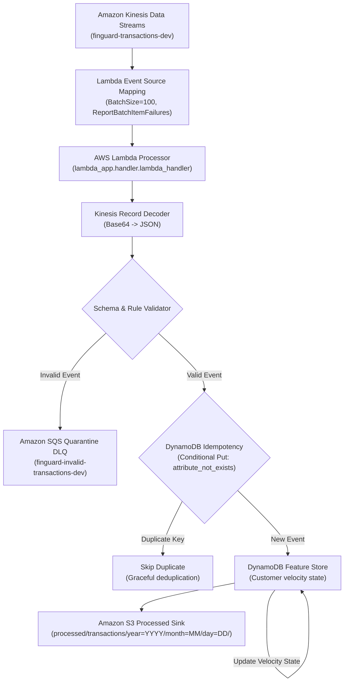

# FinGuard AI — Phase 4: AWS Lambda Real-Time Processing & Feature Engineering

## 1. Architectural Overview
Phase 4 connects Amazon Kinesis Data Streams to an event-driven serverless processing layer powered by AWS Lambda, DynamoDB, S3, and SQS.



---

## 2. Core Engineering Pillars

### 2.1 Partial Batch Failure Handling (`ReportBatchItemFailures`)
Kinesis triggers Lambda with batches of up to 100 records. Rather than allowing a single transient error to fail and re-execute all 100 records (causing duplicate side-effects on downstream systems), the Lambda function uses `ReportBatchItemFailures`:
- Unhandled errors during record processing capture the specific `sequenceNumber`.
- The handler returns:
  ```json
  {
    "batchItemFailures": [
      { "itemIdentifier": "sequence_number_failed" }
    ]
  }
  ```
- Kinesis retries only the failed sequence numbers, reducing redundant executions and backpressure.

### 2.2 Exactly-Once Semantics via DynamoDB Idempotency
- **Table:** `finguard-idempotency-dev`
- **Partition Key:** `transaction_id` (String)
- **Mechanism:** `ConditionExpression="attribute_not_exists(transaction_id)"`
- **TTL:** 7-day automatic time-to-live expiration to prevent unbounded growth.
- If a record is redelivered due to network retries, DynamoDB raises `ConditionalCheckFailedException`, which the processor intercepts to skip processing without error.

### 2.3 Real-Time Behavioral Feature Store
- **Table:** `finguard-customer-state-dev`
- **Partition Key:** `customer_id` (String)
- **Computed Real-Time Features:**
  - `transaction_count_5m_prior`: Number of transactions in preceding 300 seconds.
  - `transaction_count_1h_prior`: Number of transactions in preceding 3600 seconds.
  - `average_amount_1h_prior`: Rolling average transaction value in preceding 1 hour.
  - `amount_vs_prior_average`: Ratio of current transaction amount to 1h baseline.
  - `new_device_flag`: 1 if `device_id` is unseen in customer device set, else 0.
  - `home_city_mismatch`: 1 if payment city deviates from `home_city`, else 0.
  - `is_international`: 1 if cross-border, else 0.
  - `amount_log1p`: $\log(1 + \text{amount})$ feature scaling for machine learning.

### 2.4 Invalid Event Quarantine (Amazon SQS)
- Malformed JSON, missing required fields, or non-numeric/negative transaction amounts are immediately quarantined to Amazon SQS (`finguard-invalid-transactions-dev`).
- Preserves complete diagnostic metadata (`error_code`, `error_message`, `raw_payload`, `sequence_number`) without blocking the Kinesis shard iterator.

### 2.5 Processed S3 Data Lake Storage
- Enriched transaction records with calculated features are stored in Amazon S3:
  `s3://{processed_bucket}/processed/transactions/year=YYYY/month=MM/day=DD/{transaction_id}.json`
- Optimizes date-partitioned Hive / Athena queries for Phase 5.

