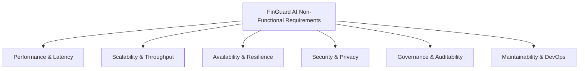

# FinGuard AI — Non-Functional Requirements Specification

## 1. Non-Functional Requirements Categories

---

## 2. Quantitative Performance & Throughput Targets

| Category | Metric | Production Target | Initial Dev/Test Environment Target |
| :--- | :--- | :--- | :--- |
| **Throughput** | Sustained Transaction Ingestion | $\ge 2,500$ TPS | $\ge 100$ TPS |
| **Throughput** | Peak Ingestion Burst | $\ge 5,000$ TPS | $\ge 250$ TPS |
| **Latency** | End-to-End Scoring Latency (p95) | $< 1,000$ ms | $< 5,000$ ms |
| **Latency** | End-to-End Scoring Latency (p99) | $< 2,500$ ms | $< 8,000$ ms |
| **Latency** | FastAPI Endpoint Response (p95) | $< 150$ ms | $< 300$ ms |
| **Latency** | Bedrock GenAI Report Generation | $< 4,000$ ms | $< 7,000$ ms |
| **Data Quality** | GenAI Output Schema Validation | $> 99\%$ valid JSON | $\ge 95\%$ valid JSON |

---

## 3. Reliability, Fault Tolerance & Idempotency

1. **Idempotency Guarantee:**
   - Every transaction payload contains a globally unique `transaction_id`.
   - Streaming consumers must use an in-memory or database idempotency cache to prevent duplicate scoring or duplicate case creation during network retries.
2. **Dead-Letter Queue (DLQ):**
   - Ingestion failures or unparsable payloads must be routed to an Amazon SQS DLQ after 3 failed Lambda execution attempts without blocking the main Kinesis shard iterator.
3. **High Availability:**
   - Multi-AZ RDS PostgreSQL with automated failover (< 60s).
   - Kinesis streams replicate data across 3 Availability Zones within the `ap-south-1` region.
   - Target availability SLA of 99.9% uptime for payment evaluation endpoints.

---

## 4. Security, Governance & Regulatory Compliance

1. **Least-Privilege Execution:** Every Lambda function and ECS task assumes an IAM role granting access strictly to the resources required (e.g., Lambda write access limited to specific S3 bronze prefix and SageMaker endpoint invocation).
2. **KMS Encryption:** All data at rest encrypted using AWS KMS Customer Managed Keys (CMKs) with annual key rotation enabled.
3. **Data Protection & PII Masking:**
   - Sensitive identifiers (card numbers, phone numbers, IP addresses) must be masked in logs and reports.
   - Unrestricted raw database access prohibited; all reads governed via RBAC REST endpoints.
4. **Model Reproducibility:**
   - Model artifacts, training hyperparameters, and feature definitions must be versioned in SageMaker Model Registry and Git.
   - Re-running training pipelines on historical Gold datasets must yield reproducible evaluation metrics within $\pm 0.5\%$ variance.
